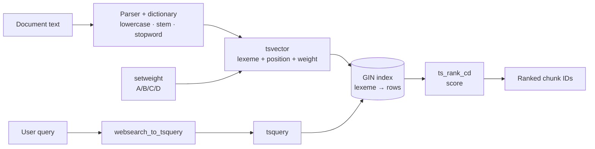
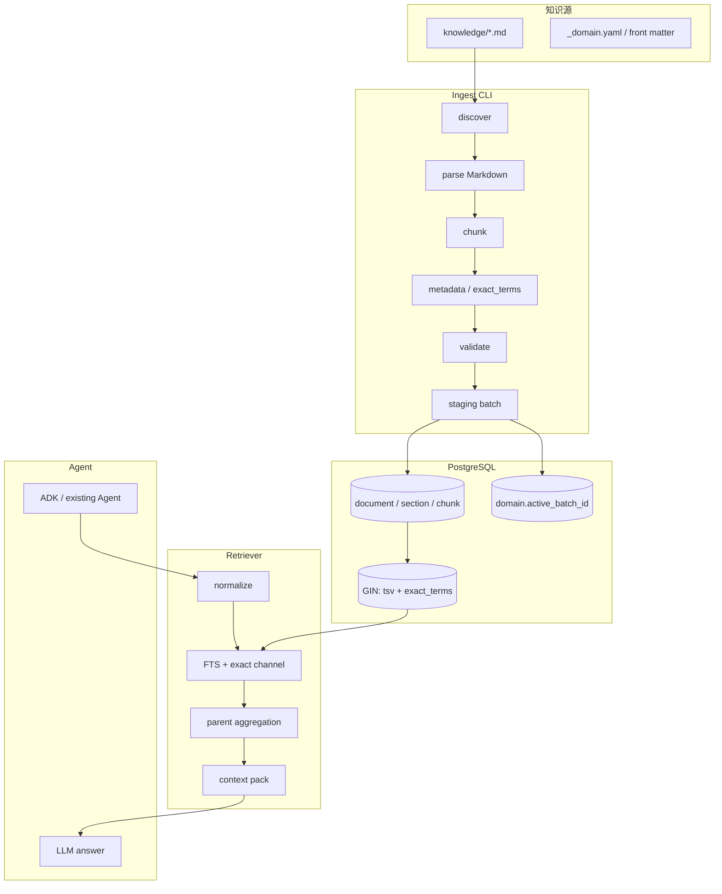
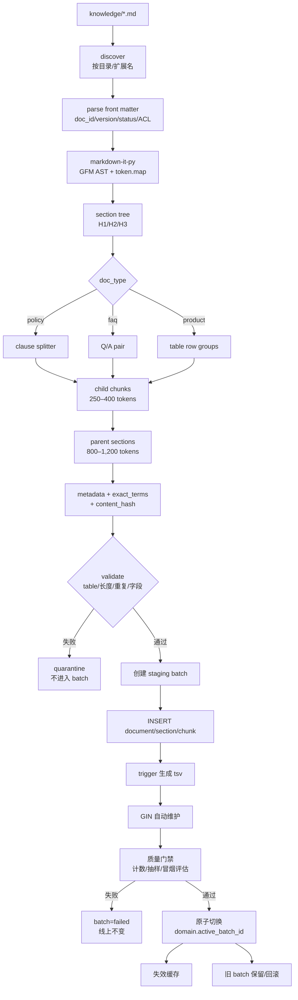
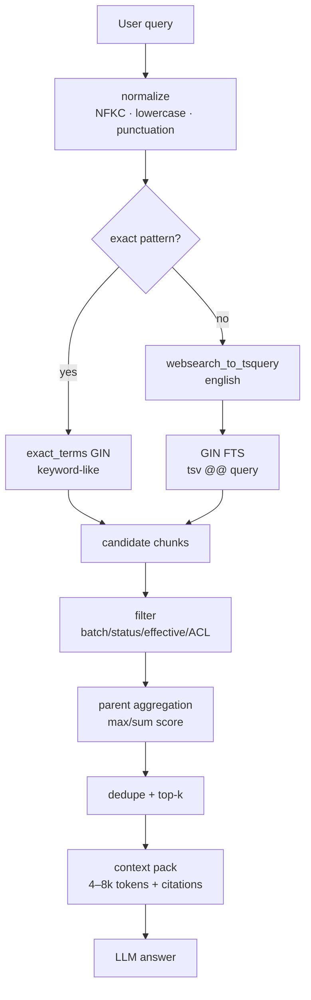
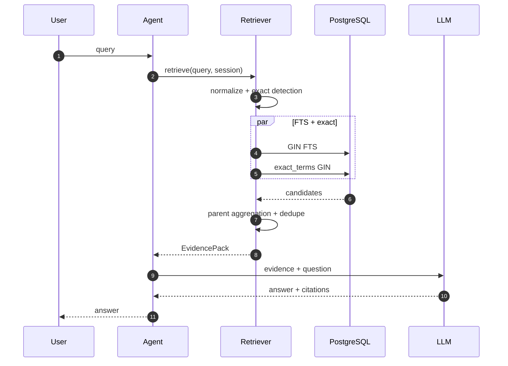

# 方案 A 执行计划：基于 PostgreSQL FTS 的稀疏倒排索引 POC

> **文档性质**：POC 实施计划 / 交接文档  
> **日期**：2026-11-08  
> **适用工程**：`adk-rag/`  
> **关联文档**：[方案讨论报告.md](方案讨论报告.md)（A/B/C 选型）、[Research.md](Research.md)（详细调研）  
> **前提**：知识文档为 **英文 Markdown**；本方案 **不使用 embedding**，不讨论中文分词。  
> **目标**：让一个新的会话/工程师只读本文就能开始实现，不需要重新推导方案。  
> **图表说明**：文中的 Mermaid 是 Markdown 里的文本流程图语法，GitHub、VS Code（装 Mermaid 插件）等可直接渲染。  
> **新会话最小上下文**：英文 Markdown；方案 A；PostgreSQL FTS（`tsvector`+GIN）；1 个 `deposit` 域 + 20 条问题；ADK 2.x；Python 3.12；无 embedding；无 Tantivy/Whoosh/ES。

---

## 0. 怎么使用本文

- **先读第 1–4 章**：理解范围、术语、为什么选 PostgreSQL FTS。
- **实现时读第 5–9 章**：架构、索引定义、建索引流程、查询流程、分块规范。
- **排期/验收读第 10–14 章**：POC 步骤、测试、运维、风险、Definition of Done。
- **附录**：Evidence 结构、exact_terms 示例、参考资料、新会话启动提示。

本文的定位是**执行计划**，不是最终代码。SQL 和代码片段是“示意 + 契约”，实现时可以调整命名/目录，但不要改变以下核心决策：

1. 方案 A 使用**稀疏倒排索引**，不引入 embedding；
2. 主实现使用 **PostgreSQL FTS（`tsvector` + GIN，`english` 配置）**；
3. 正文用全文检索，文号/产品代码/金额/日期用**独立 exact 通道**；
4. 文档更新走 **staging batch + 原子切换**，不原地覆盖线上索引；
5. Tantivy / Whoosh 只作为可选替代，不作为本 POC 的 baseline。

---

## 1. 执行摘要

### 1.1 要建什么

一条**无 embedding 的英文知识检索链路**：

```text
Markdown 文档
  → 结构感知分块（child + parent）
  → 英文规范化 + PostgreSQL FTS
  → GIN 倒排索引
  → 查询时 FTS + exact 双通道
  → 父级聚合 + 版本/ACL 过滤
  → 4–8k tokens 证据包
  → 交给现有 Agent / LLM（Large Language Model，大语言模型）回答
```

### 1.2 核心决策

| 决策 | 选择 | 理由 |
|---|---|---|
| 检索范式 | 稀疏倒排索引 | 无 embedding；精确词项强；成本低 |
| 索引引擎 | PostgreSQL FTS + GIN | 与 PGVector 同库；事务/ACL/更新简单；英文无需自定义扩展 |
| 排序 | `ts_rank_cd` 起步 | PostgreSQL 内置；字段权重可调 |
| 严格 BM25 | 可选，不作为 baseline | 如排序不足，再换 `rank_bm25`/`bm25s`/`pg_search` |
| 正文检索 | `tsvector` 全文检索 | 支持 stemming、stopword、短语、布尔 |
| 精确检索 | `exact_terms` 数组 + GIN | 文号/产品代码/金额/日期不能被 stemming 破坏 |
| 分块 | 结构感知父子块 | 保留条款/表格；child 检索、parent 生成 |
| 更新 | 每域 staging batch + `active_batch_id` | 查询不读半成品；可回滚 |
| Tantivy/Whoosh | 不进入 baseline | 额外索引系统/同步/运维；当前规模不需要 |

### 1.3 成功标准（POC）

**第一阶段：1 个域（建议 `deposit`）+ 20 条英文问题**

| 指标 | 目标 |
|---|---|
| Recall@10 | ≥ 0.85；相对固定切分基线 +20% |
| 文号/产品代码命中率 | ≥ 0.95 |
| 表格/列举题要点覆盖 | ≥ 0.85 |
| 检索 p95 | < 200 ms |
| 空召回率 | < 10%（可解释的空召回除外） |
| ACL 越权 / 过期版本 | 0 |
| 更新/回滚 | 不发应用版；回滚 < 5 分钟 |

**第二阶段：5 个域 + 60 条问题**

- 跨域问题的多域召回 ≥ 0.80；
- 端到端 p95 ≤ 8 s（含 LLM 生成）；
- 形成消融报告：A 基线 vs 加 exact vs 加 parent aggregation。

**成本直觉：**

- 没有 embedding API 成本；
- GIN/表数据几 MB–几十 MB；
- 主要成本是 LLM 回答 + 约 1.5–2 人周的 POC 工程；
- 检索本身通常几十毫秒，不是延迟瓶颈；瓶颈在分块质量和 LLM 生成。

### 1.4 不在本 POC 范围内

- embedding / 向量检索 / RRF 与 dense 融合；
- cross-encoder 重排；
- Tantivy / Whoosh / Elasticsearch 作为主索引；
- 中文分词/中文 FTS；
- 多租户、HA、分布式部署；
- 前端 UI、权限管理系统；
- Agentic RAG、多轮自反思检索；
- 模型微调。

---

## 2. 背景、范围与假设

### 2.1 业务场景

5 个英文业务域，未来扩展到 20 个：

| 域 ID | 业务域 | 典型内容 |
|---|---|---|
| `aml` | AML / KYC | customer due diligence, beneficial ownership, screening |
| `deposit` | Deposits & CDs | product rules, early withdrawal, interest, required documents |
| `fx` | Cross-border Payments & FX | remittance, FX reporting, supporting documents |
| `credit` | Retail Lending | eligibility, limits, rates, post-loan management |
| `wealth` | Wealth Management | risk rating, suitability, disclosure |

英文示例：

- “What documents are required for early withdrawal of a large-denomination CD opened by a foreign customer?”
- “What if an authorized representative handles it?”
- “What does Circular [2022] No. 5 require for early withdrawal?”
- “What is the difference between early redemption and early withdrawal?”

前两个需要跨域/完整性；第三个需要精确文号；第四个需要同义/对比。**方案 A 的强项是第三个，弱项是第四个**；这就是为什么 A 是基线，而不是最终企业架构。

### 2.2 当前规模

按 [Research.md](Research.md) 的记录：

| 项 | 估值 |
|---|---:|
| 原始文本 | ~35 万字符 |
| 现有 chunk 数 | ~1,100 |
| 平均 chunk 大小 | ~320 chars/chunk |
| 未来 20 域 × 2 MB | 约 3–4 万 chunks |

这个规模非常小：

- PostgreSQL 单机足够；
- GIN 索引几 MB–几十 MB；
- 全量重建秒级–分钟级；
- 查询通常 < 50 ms；
- 不需要 Elasticsearch/Tantivy/Whoosh 集群。

> 如果按本计划建议的 250–400 tokens 重新分块，chunk 数会变化（可能降到几百到几千）；不影响“单机 PG 足够”的结论。

### 2.3 约束

| 约束 | 说明 |
|---|---|
| 延迟 | RAG 端到端 ≤ 10 s；目标 p95 ≤ 8 s；检索 p95 < 200 ms |
| Token | 每轮证据 4–8k tokens；不能整篇注入 |
| 准确性 | 文号/产品代码/金额/日期不能错 |
| 完整性 | 列举/流程题不能漏项 |
| 更新 | 知识更新不发应用版；原子切换/回滚 |
| 扩展 | 5 → 20 域，不能每域一套代码 |
| 安全 | ACL（Access Control List，访问控制列表）在检索时硬过滤；引用可审计 |
| 环境 | Python 3.12、ADK 2.x、本地 Docker PostgreSQL |

### 2.4 显式假设

实现前先确认这些假设；如不成立，回到 [方案讨论报告.md](方案讨论报告.md) 重新选型。

1. 文档以**英文 Markdown**为主，不是 PDF/DOCX/HTML；
2. POC 允许使用 PostgreSQL 的 `english` 文本搜索配置；
3. POC 不要求严格 BM25；`ts_rank_cd` 可以先作为排序基线；
4. 文档有基本的 `doc_id/version/status/effective_from/ACL` 元数据，或可以在 front matter 补齐；
5. ACL 至少能落到“域 + 文档”级；
6. 现有 Agent 通过 ADK 接入，回答模型为 DeepSeek/Gemini，检索层可以独立调用；
7. 当前 QPS 很低（POC/小范围试点），单机 PG 足够；
8. 不需要中文分词/多语言分析；
9. 可以先做 1 个域，再扩到 5 个域；
10. 允许为 POC 新建 PostgreSQL schema/表，不改现有业务表。

### 2.5 非目标

- 不解决“用户换一种说法但完全没有共享词”的语义召回；这是 B/C 的职责；
- 不保证列举题 100% 完整；父级聚合和评估只能改善；
- 不解决复杂多跳推理；
- 不做知识图谱；
- 不做实时流式索引（POC 用批处理/CLI 即可）。

---

## 3. 术语与组件：它们是什么、负责什么

> 这一章是为了让第一次接触 FTS 的读者建立正确心智模型。已经熟悉的读者可以跳到第 4 章。

### 3.1 先分清五个东西

| 名称 | 类别 | 一句话 |
|---|---|---|
| **FTS** | 检索机制 | Full-Text Search，把文本变成可检索的词条并排序 |
| **BM25** | 排序算法 | 一种经典的词项相关性打分公式 |
| **`tsvector`** | PostgreSQL 数据类型 | 文档处理后的“词条 + 位置 + 权重”表示 |
| **GIN** | PostgreSQL 索引类型 | 倒排索引：词条 → 包含它的行 |
| **`ts_rank_cd`** | PostgreSQL 函数 | 基于 cover density 的排序函数；不是 BM25 |

它们不是互相替代的关系：

```text
FTS 是一套机制
  ├── 文档侧：to_tsvector(...) → tsvector
  ├── 索引侧：GIN(tsvector)
  ├── 查询侧：websearch_to_tsquery(...) → tsquery
  └── 排序侧：ts_rank_cd(...) 或 ts_rank(...)
BM25 是另一套排序公式，不在 PostgreSQL FTS 内
```

**一个类比：**

| 概念 | 类比 |
|---|---|
| FTS | 图书馆的“主题卡片目录”：按词找书，不是让管理员通读所有书 |
| `tsvector` | 每本书的“索引卡片”：记录了哪些词、在什么位置、权重多少 |
| GIN | 书末的“术语索引”：从词条翻到页码列表，但不负责判断哪页最重要 |
| BM25 | 一位裁判：根据稀有词、词频、文档长度给相关性打分 |
| `ts_rank_cd` | 另一位裁判：根据词之间是否靠近、字段权重打分 |

### 3.2 FTS（Full-Text Search）是什么

**定义**：FTS 是一种“把自然语言文本解析成词条，并支持按词条/短语/布尔条件检索”的机制。它不是简单的 `LIKE '%keyword%'`，也不是向量检索。

**PostgreSQL FTS 的工作步骤：**

1. **Parser**：把文本切成 token（单词、数字、标点等）；
2. **Dictionary**：对 token 做归一化——小写、去 stopword（停用词，如 `the/of`）、词干化（stemming）；
3. **`tsvector`**：把处理后的 lexeme（归一化后的词条）连同位置、权重存起来；
4. **`tsquery`**：把用户查询解析成 `&`、`|`、`!`、`<->` 等结构；
5. **`@@`**：判断 `tsvector` 是否匹配 `tsquery`；
6. **GIN**：加速 `@@` 查找；
7. **`ts_rank_cd`**：对匹配到的行排序。

**英文场景的好处：**

- `english` 配置自带 Snowball stemmer，`withdraw`/`withdrawal` 会归一；
- 自带 stopword 列表；
- 支持短语查询（`"early withdrawal"`）；
- 支持布尔查询（`early & withdrawal`、`early | redemption`）；
- 不需要额外搜索引擎。

**FTS 不负责：**

- 语义相似（换一种完全不同的说法）；
- 跨语言；
- 复杂否定/例外推理；
- 关系/多跳推理。

> **关键**：FTS 是“词项匹配”，不是“语义匹配”。它的强项和弱项都很明确。

### 3.3 BM25 是什么，怎么算

**定义**：BM25（Best Matching 25）是一种词项相关性排序函数，是稀疏检索最经典的 ranking 之一。它基于三个直觉：

1. **TF 饱和**：TF（Term Frequency，词频）——一个词出现 10 次不一定比出现 2 次相关 5 倍；
2. **IDF**：IDF（Inverse Document Frequency，逆文档频率）——越罕见的词，区分度越高；
3. **长度归一化**：长文档天然有更多词，需要惩罚。

公式（单个 query term）：

```text
score(D, Q) = Σ_{q_i ∈ Q} IDF(q_i) · [ f(q_i, D) · (k1 + 1) ]
              / [ f(q_i, D) + k1 · (1 - b + b · |D| / avgdl) ]

IDF(q_i) = ln( 1 + (N - n(q_i) + 0.5) / (n(q_i) + 0.5) )
```

- `f(q_i, D)`：term 在文档中的词频；
- `|D|`：文档长度；`avgdl`：平均文档长度；
- `N`：文档数；`n(q_i)`：包含该 term 的文档数；
- `k1`：控制 TF 饱和，常用 1.2–2.0；
- `b`：控制长度归一化，常用 0.75。

**BM25 的强项**：精确词项、稀有词、长短文档混合的场景。  
**BM25 的弱项**：同义/换说法、跨语言、语义相似；它仍然只是词项匹配。

**BM25F**：BM25 的多字段版本，对 title/body 等字段分别算分再加权；Elasticsearch/Lucene 常用。

**重要**：PostgreSQL FTS 的 `ts_rank_cd` **不是 BM25**。它使用 cover density（词之间距离）和字段权重，没有 BM25 的 `k1/b`。如果团队明确要求 BM25，需要：

- 应用侧 `rank_bm25` / `bm25s`；
- ParadeDB `pg_search`；
- Elasticsearch/OpenSearch；
- Tantivy（BM25）。

本 POC 先用 `ts_rank_cd`，把 BM25 作为“排序不足时的升级项”。

### 3.4 `tsvector` 是什么

**定义**：`tsvector` 是 PostgreSQL 的全文检索数据类型，表示“文档经过解析/归一化/词干化后的 lexeme 列表”，每个 lexeme 可以带位置和权重。

示例：

```sql
SELECT to_tsvector('english', 'Early withdrawal of a CD');
-- 'cd':5 'earli':1 'withdraw':2
```

说明：

- `Early` → `earli`（stemming）；
- `withdrawal` → `withdraw`；
- `of/a` 可能被 stopword 去掉；
- 数字/位置可用于短语/邻近查询。

**`tsvector` 不是原文**：

- 不能拿它当回答内容；
- 原文仍在 `chunk.text`；
- `tsvector` 只用于索引/匹配/排序。

**权重**：

```sql
setweight(to_tsvector('english', heading_path), 'A') ||
setweight(to_tsvector('english', text), 'B')
```

A/B/C/D 是权重标签；默认权重 A 最高，D 最低。`setweight` **只影响排序**，不改变“是否匹配”。

### 3.5 GIN 是什么，倒排索引怎么工作

**定义**：GIN = Generalized Inverted Index，PostgreSQL 的通用倒排索引类型。它不仅可以索引 `tsvector`，还可以索引数组（`text[]`）、JSONB（PostgreSQL 的二进制 JSON 类型）等。

**倒排索引的直觉**：

普通索引是“行 → 值”；倒排索引是“值 → 行”。

```text
chunk 1: early withdrawal policy
chunk 2: early redemption rules
chunk 3: withdrawal limits

倒排表：
early      → [1, 2]
withdrawal → [1, 3]
policy     → [1]
redemption → [2]
rules      → [2]
limits     → [3]
```

查询 `early & withdrawal`：

1. 取 `early` 的 posting list：`[1,2]`；
2. 取 `withdrawal` 的 posting list：`[1,3]`；
3. 求交集：`[1]`；
4. 回表取 chunk 1 的文本/元数据。

**GIN 的内部要点（POC 需要知道的）：**

- GIN 为每个 lexeme 维护 posting list/tree（倒排列表：词条 → 行 ID 列表）；
- 查询 `tsv @@ query` 时，GIN 先找候选行（bitmap），再回表；
- GIN 不负责排序；排序由 `ts_rank_cd` 等函数完成；
- GIN 有 pending list（`fastupdate`）：新写入先进入 pending list，后续合并；
- 大量更新后需要 `VACUUM` / `gin_clean_pending_list`；
- 生产建索引用 `CREATE INDEX CONCURRENTLY`，避免锁表；
- GIN 对 `tsvector` 会保留位置信息，因此支持短语/邻近查询。

**GIN vs B-tree：**

- B-tree 适合等值/范围（`domain_id`、`status`、`effective_from`）；
- GIN 适合“包含/匹配”（`tsv @@ query`、数组 overlap）；
- 不要把长文本塞进 B-tree；也不要用 GIN 做范围过滤。

### 3.6 `tsquery`、`websearch_to_tsquery`、`@@`

- **`tsquery`**：查询解析后的结构，例如 `'earli' & 'withdraw'`；
- **`websearch_to_tsquery('english', $1)`**：把用户输入转成 `tsquery`，支持：
  - `"early withdrawal"` → 短语；
  - `early OR redemption` → OR；
  - `early -redemption` → 排除；
- **`@@`**：匹配运算符，`tsv @@ query` 返回 bool。

示例：

```sql
SELECT websearch_to_tsquery('english', '"early withdrawal" OR redemption');
-- 'earli' <-> 'withdraw' | 'redempt'
```

### 3.7 `ts_rank_cd` 是什么

**定义**：PostgreSQL 的 cover density 排序函数。它不只数词频，还会考虑 query term 在文档中的“覆盖密度”（词之间是否靠近），并结合 `setweight` 的权重。

```sql
ts_rank_cd(tsv, query, 32)
```

- 第一个参数：文档的 `tsvector`；
- 第二个参数：`tsquery`；
- 第三个参数：normalization flag（不是阈值）；常用 0/1/2/4/8/16/32 或组合，控制长度/排名归一化；
- 返回 float，越高越相关。

**它不是 BM25**：

- 没有 `k1/b`；
- 使用 cover density，不是 BM25 的 TF 饱和/长度归一化公式；
- 对很多企业检索够用，但排序质量和 BM25 不完全一样。

### 3.8 Keyword 检索：什么是 keyword，什么时候用

“Keyword”在不同系统里含义不同：

| 系统 | Keyword 的含义 |
|---|---|
| Elasticsearch | `keyword` 类型：不分词、整串精确匹配，适合 ID/枚举/标签 |
| Tantivy | `STRING`/raw tokenizer：整串索引，适合 ID |
| PostgreSQL | 没有 `keyword` 类型；用 `text` + B-tree/数组/`citext` 模拟精确匹配 |

在本方案里：

- **正文**用 `tsvector` 全文检索（text-like）；
- **文号/产品代码/金额/日期/枚举**用 `exact_terms` 数组 + GIN（keyword-like）；
- **`domain_id/status/effective/ACL`** 用 B-tree/GIN 过滤（结构化字段）。

**为什么不能只用 keyword？**

- 正文是自然语言，需要 stemming、stopword、短语、布尔；
- keyword-only 对 “withdraw” vs “withdrawal” 不归一；
- 对长文本，keyword 索引用处很小。

**为什么不能只用 text/FTS？**

- 文号 `Circular [2022] No. 5` 可能被 tokenizer/stemmer 拆开；
- 产品代码 `CD-2026-001` 可能被拆成 `cd`、`2026`、`001`；
- 金额/日期需要精确匹配，不能被 stemming 改写。

**结论**：**两者都用，但分工明确**。正文 FTS；精确字段 keyword-like；查询时按意图路由/融合。

### 3.9 其他库/组件

| 名称 | 是什么 | 在本方案中的作用 | 不负责什么 |
|---|---|---|---|
| **`markdown-it-py`** | Python 的 CommonMark/GFM（GitHub Flavored Markdown）解析器 | 把 Markdown 解析成 token/AST（抽象语法树），保留 `token.map` 行号 | 不做分块、不做检索 |
| **`python-frontmatter`** | YAML front matter 解析库 | 读取 `doc_id/version/status/ACL` | 不做 schema 校验 |
| **`psycopg`** | PostgreSQL 的 Python 驱动（v3） | 执行 SQL、事务、参数化查询 | 不做 ORM/检索 |
| **`pydantic`** | 数据校验/序列化库 | 定义 `Chunk`、`Evidence`、`QueryPlan` 等模型 | 不做数据库 |
| **`pytest`** | Python 测试框架 | 单元/集成测试 | 不做评估指标 |
| **`rank_bm25`** | 纯 Python BM25 实现 | 可选的严格 BM25 基线 | 不做持久化/并发/ACL |
| **`bm25s`** | 更快的 BM25 实现（稀疏矩阵） | 可选的高性能 BM25 | 同上 |
| **`pg_trgm`** | PostgreSQL 三元组相似度扩展 | 可选的模糊/子串兜底 | 不是 BM25，不是语义检索 |
| **Tantivy / `tantivy-py`** | Rust 的嵌入式全文搜索引擎 | 可选替代 PG FTS；BM25/倒排 | 不做 metadata/ACL/版本/融合 |
| **Whoosh-reloaded** | 纯 Python 全文搜索库 | 可选原型/离线索引；BM25F | 性能/生态不如 Tantivy/PG |
| **PGVector** | PostgreSQL 向量扩展 | POC 的 A 方案**不用**；保留给 B/C | 不做全文检索 |
| **Google ADK** | Agent 开发框架 | 接入现有 Agent、回调/工具 | 不做检索/排序 |

### 3.10 一张图看清关系



> 记住：**`tsvector` 是文档表示，GIN 是倒排索引，`tsquery` 是查询表示，`ts_rank_cd` 是排序器。** 四者分工不同。

---

## 4. 为什么选 PostgreSQL FTS，而不是 Tantivy/Whoosh

### 4.1 方案对比

| 维度 | PostgreSQL FTS | Tantivy | Whoosh-reloaded |
|---|---|---|---|
| 索引维护 | trigger + GIN 自动 | 手动 commit/reload/merge | 手动 commit/reload |
| BM25 | 否，`ts_rank_cd` | 是 | 是（BM25F） |
| 与 chunk/metadata 同库 | 是 | 否，需要同步 | 否，需要同步 |
| ACL/版本过滤 | SQL 直接过滤 | 需要字段/后置过滤 | 需要字段/后置过滤 |
| 事务/原子切换 | 原生 | 需自己设计 | 需自己设计 |
| 运维复杂度 | 低 | 中 | 中 |
| 当前 1,100 chunks | 足够 | 足够 | 足够 |
| 适合 | **本 POC** | 严格 BM25/嵌入式 | 原型/离线 |

### 4.2 决策

- **本 POC 选 PostgreSQL FTS**：少一个索引系统，事务/ACL/批次都在 SQL 里，英文不需要自定义扩展。
- **Tantivy** 只在“明确需要严格 BM25 + 嵌入式索引”时评估；它替代索引/排序，不替代分块/metadata/ACL/融合。
- **Whoosh-reloaded** 只适合原型/离线；不作为生产首选。
- **如果只想要 BM25**：先试 `rank_bm25`/`bm25s` 或 ParadeDB `pg_search`，不一定要引入 Tantivy/Whoosh。

### 4.3 放弃了什么

选择 PG FTS 意味着放弃：

- BM25 的排序公式（先用 `ts_rank_cd`）；
- Tantivy 的倒排性能/BM25 控制力；
- 独立的搜索集群能力（当前规模不需要）。

这不是“永久决定”：`SparseRetriever` 接口保留，后续可以换 Tantivy/Whoosh/ES；`chunk_id` 和 metadata 不变。

---

## 5. 总体架构

### 5.1 组件



### 5.2 组件职责

| 组件 | 职责 | 不负责 |
|---|---|---|
| `knowledge/` | Markdown 文档 + front matter + 域卡片 | 不做解析/索引 |
| `Ingest CLI` | 发现、解析、分块、metadata、校验、写 batch | 不做在线查询 |
| PostgreSQL | 存 chunk/section/document、GIN 索引、批次 | 不做 LLM 生成 |
| `Retriever` | 查询归一化、FTS/exact、父级聚合、context pack | 不做最终回答 |
| `ADK/Agent` | 对话、调用 retriever、注入证据、生成 | 不做检索排序 |
| `eval/` | 金标集、Recall/nDCG/延迟 | 不做线上服务 |

### 5.3 部署形态

POC 最小部署：

```text
docker compose:
  - postgres: pgvector/pgvector:pg17
  - app: Python 3.12 + ADK + Retriever
```

- A 方案不依赖 `pgvector` 扩展；用 `pgvector/pgvector:pg17` 只是为后续 B/C 预留；
- embedding/LLM 可以是外部 API 或本地服务；
- POC 不需要 Redis/ES/Tantivy/Whoosh；
- 生产再加连接池、监控、备份、只读副本。

---

## 6. 索引定义

### 6.1 稀疏索引还是稠密索引？

**方案 A 使用稀疏倒排索引，不使用稠密向量索引。**

先澄清“稠密/稀疏”的两个语境：

| 语境 | 稠密（dense） | 稀疏（sparse） |
|---|---|---|
| **IR/RAG** | embedding 向量，几乎每维都有值 | 词项 postings，绝大多数词项为 0 |
| **数据库索引** | 每个数据行都有索引项（如普通 B-tree） | 每个块一个索引项（如稀疏索引文件） |

本文说“方案 A 是稀疏索引”，指的是 **IR 语境**：它用词项倒排表，而不是 embedding 向量。GIN 是倒排索引；B-tree 是结构化过滤索引，不是本方案的“检索索引”。

| 维度 | 稀疏倒排（A） | 稠密向量（B） |
|---|---|---|
| 表示 | term → posting list | embedding 向量 |
| 查询 | 词项/短语/布尔匹配 | 向量相似度 |
| 强项 | 精确词、编号、数字 | 同义/换说法/语义 |
| 弱项 | 词汇鸿沟 | 精确编号/否定 |
| 本方案 | **使用** | **不使用** |

> 因此，A 的 `chunk` 表不需要 `embedding` 列；不要为了“以后可能用”先把向量列塞进 A 的 schema。B/C 再加列/表。

### 6.2 是否使用 Keyword 检索？

**使用，但只用于“精确字段”，不用于正文。**

| 内容 | 检索方式 | 原因 |
|---|---|---|
| 正文/条款/段落 | `tsvector` 全文检索（text-like） | 需要 stemming、stopword、短语、布尔 |
| 文号/产品代码/金额/日期 | `exact_terms` 数组 + GIN（keyword-like） | 不能被分词/stemming 破坏 |
| `domain_id/status/effective/ACL` | B-tree/GIN 过滤 | 结构化字段，不需要全文检索 |
| 标题/章节路径 | `tsvector` 权重 A | 用于排序 boost，不单独做 keyword |

**为什么不能只用 keyword：**

- 正文是自然语言，`withdraw`/`withdrawal` 需要归一；
- keyword-only 不支持短语/布尔/相关性排序；
- 长文本逐字匹配召回很低。

**为什么不能只用 text/FTS：**

- `Circular [2022] No. 5` 可能被拆成多个 token；
- `CD-2026-001` 可能被 stem/拆开；
- 金额/日期需要精确匹配。

**查询路由：**

```text
query
  ├── 含文号/产品代码/金额/日期模式 → exact_terms 通道
  ├── 自然语言 → FTS 通道
  └── 两者都有 → 两路并行 + 融合
```

在 PostgreSQL 里没有 `keyword` 类型；`exact_terms` 数组 + GIN 就是 keyword-like 的实现。若用 Tantivy/ES，对应 `STRING`/`keyword` 字段。

### 6.3 完整 Schema

```sql
-- 可选：仅当使用 pgvector 镜像/后续 B/C 时启用
-- CREATE EXTENSION IF NOT EXISTS vector;

CREATE TABLE domain (
  id               text PRIMARY KEY,
  name             text NOT NULL,
  description      text NOT NULL,
  card             jsonb NOT NULL DEFAULT '{}',
  acl_groups       text[] NOT NULL DEFAULT '{}',
  active_batch_id  bigint,
  updated_at       timestamptz NOT NULL DEFAULT now()
);

CREATE TABLE document (
  id               text PRIMARY KEY,          -- doc_id@version
  doc_id           text NOT NULL,             -- 业务稳定 ID
  domain_id        text NOT NULL REFERENCES domain(id),
  path             text NOT NULL,
  title            text NOT NULL,
  version          text NOT NULL,
  doc_type         text NOT NULL,
  status           text NOT NULL CHECK (status IN ('draft','scheduled','active','archived')),
  effective_from   date,
  effective_to     date,
  classification   text NOT NULL,
  acl_groups       text[] NOT NULL DEFAULT '{}',
  content_hash     text NOT NULL,
  parser_version   text NOT NULL,
  updated_at       timestamptz NOT NULL DEFAULT now(),
  UNIQUE (domain_id, doc_id, version)
);

CREATE TABLE section (
  id               text PRIMARY KEY,
  document_id      text NOT NULL REFERENCES document(id),
  parent_id        text REFERENCES section(id),
  heading_path     text NOT NULL,
  level            int NOT NULL,
  ordinal          int NOT NULL,
  text             text NOT NULL,
  token_count      int NOT NULL
);

CREATE TABLE chunk (
  id               text PRIMARY KEY,
  domain_id        text NOT NULL REFERENCES domain(id),
  document_id      text NOT NULL REFERENCES document(id),
  section_id       text NOT NULL REFERENCES section(id),
  parent_id        text REFERENCES section(id),
  ordinal          int NOT NULL,
  doc_type         text NOT NULL,
  heading_path     text NOT NULL,
  text             text NOT NULL,
  token_count      int NOT NULL,
  status           text NOT NULL CHECK (status IN ('draft','scheduled','active','archived')),
  effective_from   date,
  effective_to     date,
  classification   text NOT NULL,
  acl_groups       text[] NOT NULL DEFAULT '{}',
  exact_terms      text[] NOT NULL DEFAULT '{}',
  content_hash     text NOT NULL,
  chunker_version  text NOT NULL,
  batch_id         bigint NOT NULL,
  source_start     int,
  source_end       int,
  tsv              tsvector
);

CREATE TABLE ingest_batch (
  id               bigserial PRIMARY KEY,
  domain_id        text NOT NULL REFERENCES domain(id),
  label            text,                   -- 人可读批次名，如 deposit-poc-001
  status           text NOT NULL,          -- staging | validated | active | failed | retired
  stats            jsonb NOT NULL DEFAULT '{}',
  started_at       timestamptz NOT NULL DEFAULT now(),
  finished_at      timestamptz
);
```

> `chunk` 里的 `domain_id/status/effective/ACL/classification` 是从 `document` 冗余下来的过滤字段；ingest 必须保证同步。这样查询不必每次 JOIN 多张表，代价是更新时要同时维护。  
> `doc_id` 建议全局唯一（带域前缀）；`document.id = doc_id@version`。如果不能保证全局唯一，把 `document.id` 改成 `domain_id:doc_id@version`。

### 6.4 字段含义与必要性

| 字段 | 类型 | 必要？ | 作用 | 缺失的后果 |
|---|---|---|---|---|
| `chunk.id` | text PK | **必须** | 稳定 chunk 身份；引用/缓存/评估 | 无法定位/更新 |
| `domain_id` | text | **必须** | 域过滤、路由、ACL | 跨域查询无法隔离 |
| `document_id` | text | **必须** | 指向 `document.id`；引用/版本 | 无法回溯原文 |
| `section_id` | text | **必须** | 指向 section；父级扩展 | 无法补全上下文 |
| `parent_id` | text | **推荐** | 父级聚合的 group key | 只能按 chunk 返回，完整性差 |
| `doc_type` | text | 必须（或默认 `policy`） | policy/faq/product；分块/排序 | 分块规则无法区分文档类型 |
| `heading_path` | text | **必须** | 上下文/引用/权重 A | 引用说不清章节；排序少一个信号 |
| `text` | text | **必须** | 原文；返回给 LLM/引用 | 无法回答/引用 |
| `token_count` | int | 推荐 | token 预算/质量检查 | 无法控制 context |
| `status` | text | **必须** | active/scheduled/archived 过滤 | 可能召回过期/草稿 |
| `effective_from` | date | **必须列；值可空** | 生效日期过滤 | 可能召回过期版本 |
| `effective_to` | date | **必须列；值可空** | 失效日期过滤 | 可能召回过期版本 |
| `classification` | text | **必须** | 数据分级/ACL | 合规风险 |
| `acl_groups` | text[] | **必须** | 权限过滤 | 越权风险 |
| `exact_terms` | text[] | **必须**（有精确查询时） | 文号/代码/金额/日期 | 精确匹配被分词破坏 |
| `content_hash` | text | **必须** | 增量更新/去重 | 每次全量重建 |
| `chunker_version` | text | **必须** | 分块器升级追踪 | 无法判断是否需要重分块 |
| `batch_id` | bigint | **必须** | staging/原子切换/回滚 | 读到半成品 |
| `source_start/end` | int | 可选 | 精确引用/定位 | 只能用 heading 引用 |
| `tsv` | tsvector | **必须** | 全文检索 | FTS 无法工作 |

> “必须”指**字段/列必须存在**；`effective_from/effective_to` 的值可以为 `NULL`（表示长期有效/未设置），但查询语义要明确。  
> `acl_groups` 为空默认不匹配任何用户；公开文档请显式放 `public` 组，或查询时显式放行。

`document` / `section` 的关键字段（服务于引用、父级扩展、版本，不直接参与 FTS）：

- `document`：`id`（doc_id@version）、`doc_id`、`version`、`status`、`effective_from/to`、`classification`、`acl_groups`、`content_hash`、`parser_version`；
- `section`：`id`、`document_id`、`parent_id`、`heading_path`、`level`、`ordinal`、`text`、`token_count`。

### 6.5 索引定义

```sql
-- 倒排索引：正文全文检索
CREATE INDEX chunk_tsv_gin ON chunk USING gin (tsv);

-- keyword-like：精确词
CREATE INDEX chunk_exact_gin ON chunk USING gin (exact_terms);

-- 结构化过滤
CREATE INDEX chunk_filter_btree
  ON chunk (domain_id, status, effective_from, effective_to);

-- ACL 过滤
CREATE INDEX chunk_acl_gin ON chunk USING gin (acl_groups);

-- 父级聚合
CREATE INDEX chunk_parent_btree ON chunk (parent_id);

-- 批次清理/切换
CREATE INDEX chunk_batch_btree ON chunk (batch_id);
```

说明：

- **GIN 是倒排索引**，负责 `tsv @@ query` 和 `exact_terms && ARRAY[...]`；
- **B-tree 只做过滤**，不做全文检索；
- 初始导入时可以先不建 GIN，导入完再 `CREATE INDEX`（更快）；POC 数据小，直接建也行；
- 生产用 `CREATE INDEX CONCURRENTLY`，避免锁表；
- 大量更新后关注 GIN pending list，必要时 `VACUUM` / `gin_clean_pending_list`。

### 6.6 `tsv` 与 `setweight`

`tsv` 由 trigger 维护，不依赖应用每次手写：

```sql
CREATE OR REPLACE FUNCTION update_chunk_tsv() RETURNS trigger AS $$
BEGIN
  NEW.tsv :=
    setweight(to_tsvector('english', coalesce(NEW.heading_path, '')), 'A') ||
    setweight(to_tsvector('english', coalesce(NEW.text, '')), 'B');
  RETURN NEW;
END
$$ LANGUAGE plpgsql;

CREATE TRIGGER trg_chunk_tsv
BEFORE INSERT OR UPDATE OF heading_path, text ON chunk
FOR EACH ROW EXECUTE FUNCTION update_chunk_tsv();
```

为什么用 trigger，而不是 generated column：

- `to_tsvector(regconfig, text)` 的 immutable 性/版本行为需要确认；
- trigger 更直观，权重/字段可以随时调整；
- 迁移/回填更容易；
- 代价是每次写入多一次函数调用，但 POC 规模很小。

`setweight` 的 A/B 是排序权重：

- heading_path A：标题/章节命中更重要；
- body B：正文；
- 默认权重 A 最高；可用 `ts_rank_cd` 的 normalization/权重调。

### 6.7 exact_terms 的生成

应用侧在 ingest 时从 `heading_path + text` 抽取：

- 文号：`Circular [2022] No. 5`、`Notice 2023-12`；
- 产品代码：`CD-2026-001`；
- 金额：`USD 100,000`、`20 million`；
- 日期：`2026-01-01`、`January 1, 2026`；
- 比例：`3.25%`；
- 其他业务代码。

规则：

- 统一小写/空白/全半角；
- 保留原始字符串 + 规范化字符串（可选两列/两个数组元素）；
- 不要 stemming；
- 不要过滤数字；
- 每个 chunk 的 `exact_terms` 去重；
- 查询侧用同样的正则抽取，命中即 boost。

### 6.8 查询 SQL

```sql
WITH q AS (
  SELECT websearch_to_tsquery('english', $1) AS query
),
fts AS (
  SELECT c.id, c.parent_id, c.heading_path, c.text,
         ts_rank_cd(c.tsv, q.query, 32) AS score
  FROM chunk c
  JOIN domain d ON d.id = c.domain_id AND d.active_batch_id = c.batch_id
  CROSS JOIN q
  WHERE c.tsv @@ q.query
    AND c.domain_id = ANY($2)
    AND c.status = 'active'
    AND (c.effective_from IS NULL OR c.effective_from <= $3)
    AND (c.effective_to IS NULL OR c.effective_to > $3)
    AND c.acl_groups && $4
  ORDER BY score DESC
  LIMIT 80
),
exact AS (
  SELECT c.id, c.parent_id, c.heading_path, c.text,
         1.0 AS score
  FROM chunk c
  JOIN domain d ON d.id = c.domain_id AND d.active_batch_id = c.batch_id
  WHERE c.exact_terms && ARRAY[$1]
    AND c.domain_id = ANY($2)
    AND c.status = 'active'
    AND (c.effective_from IS NULL OR c.effective_from <= $3)
    AND (c.effective_to IS NULL OR c.effective_to > $3)
    AND c.acl_groups && $4
  LIMIT 20
)
SELECT * FROM fts
UNION ALL
SELECT * FROM exact
WHERE NOT EXISTS (SELECT 1 FROM fts WHERE fts.id = exact.id);
```

说明：

- `fts` 和 `exact` 的 score 不可直接比较；生产实现应在应用层做 RRF/加权，而不是简单 `UNION ALL` 排序；
- 上面的 SQL 只展示“两路候选”；
- `parent_id` 聚合在应用层或下一层 SQL 做；
- `$4` 是 `text[]`（用户组）；
- `$1` 同时用于 FTS 和 exact 是简化；实际应使用“原始 query”和“抽取出的 exact terms”两个参数；
- 日期语义：`effective_from <= as_of < effective_to`（左闭右开）；如果业务按“含到期日”，把 `>` 改成 `>=`。

### 6.9 旧批次与 GIN 膨胀

如果所有 batch 都留在 `chunk` 表：

- GIN 索引会包含旧 batch 的行；
- `batch_id`/`active_batch_id` 过滤发生在索引扫描之后，可能降低召回/增加扫描；
- 旧行越多，GIN 越大，`VACUUM` 越慢。

POC 处理：

- 查询必须带 `JOIN domain ... active_batch_id = c.batch_id`；
- 可以过采样（`LIMIT 80`）；
- 只保留最近 1–2 个 batch；
- 定期 `VACUUM`；
- 生产可把旧 batch 移到 `chunk_archive` 表，或按 batch 分区。

### 6.10 如果改用 Tantivy/Whoosh

| 能力 | PG FTS | Tantivy | Whoosh-reloaded |
|---|---|---|---|
| 倒排索引 | GIN | 内置 | 内置 |
| BM25 | 否 | 是 | 是（BM25F） |
| 索引维护 | trigger/GIN 自动 | 手动 commit/reload/merge | 手动 commit/reload |
| 元数据/ACL | SQL | 字段/后置 | 字段/后置 |
| 事务/原子切换 | 原生 | 自己设计 | 自己设计 |
| 当前规模 | 足够 | 足够 | 足够 |

**它们替代：**

- `tsvector`/GIN 的倒排存储与查找；
- `ts_rank_cd`/BM25 的排序；
- 部分 query parser/analyzer。

**它们不替代：**

- Markdown 解析/分块/父子块；
- metadata/版本/ACL/批次；
- RRF、cross-encoder、context packing、评估、ADK。

**建议**：本 POC 不引入；如果确实需要严格 BM25，先用 `rank_bm25`/`bm25s` 或 `pg_search`，再考虑 Tantivy；Whoosh 只用于原型。Elasticsearch/OpenSearch 的英文 BM25/分析器最成熟，但多一个集群；当前 1,100 chunks 不需要。

---

## 7. 索引创建/更新流程

### 7.1 流程图



### 7.2 步骤说明

| 步骤 | 做什么 | 产出/检查 |
|---|---|---|
| 1. Discover | 遍历 `knowledge/{domain}/*.md`；读取 `_domain.yaml` | 文件清单 |
| 2. Front matter | 解析 YAML；校验 `doc_id/version/status/effective/ACL` | 缺字段进 quarantine |
| 3. Parse | `markdown-it-py` GFM；保留 `token.map` | AST/section |
| 4. Section tree | H1/H2/H3 建树；heading_path | parent sections |
| 5. Chunk | 按 doc_type 选择 clause/FAQ/table 规则 | child chunks |
| 6. Metadata | 写 domain/doc/version/status/ACL/exact_terms/hash | chunk rows |
| 7. Validate | 空块/超长/表格/条款/重复/token | 通过/隔离 |
| 8. Batch | 创建 `ingest_batch`，状态 `staging` | batch_id |
| 9. Insert | 写 document/section/chunk；`batch_id` | 行数 |
| 10. Trigger | `tsv` 自动生成 | FTS 可查 |
| 11. GIN | 索引自动维护 | 查询可用 |
| 12. Gate | 计数/抽样/10–20 条冒烟 | 通过/失败 |
| 13. Promote | 事务更新 `domain.active_batch_id` | 线上切换 |
| 14. Cache | 按域/版本失效 | 新查询生效 |
| 15. Rollback | 指回旧 batch | 5 分钟内 |

### 7.3 初始建索引 vs 增量更新

> **staging batch**：新索引先写入的“暂存批次”，不直接服务线上；`promote` 只切换 `active_batch_id` 指针，不覆盖旧数据。

**初始建索引：**

1. 建表/trigger；
2. 可先不建 GIN；
3. 批量导入 chunk；
4. `CREATE INDEX chunk_tsv_gin ...`；
5. `CREATE INDEX chunk_exact_gin ...`；
6. `ANALYZE chunk`；
7. 冒烟评估；
8. 切换 active batch。

**增量更新：**

1. 解析变更文档；
2. doc hash / chunk hash 对比；
3. 只重写变更 chunk；
4. 新 batch；
5. trigger 更新 `tsv`；
6. GIN 自动更新；
7. 质量门禁；
8. 切换；
9. 旧 batch 保留。

### 7.4 自动化程度

| 任务 | 自动？ | 机制 |
|---|---|---|
| Schema / GIN / trigger | **手工一次** | migration + DDL |
| `tsv` 生成 | **自动** | trigger |
| GIN 维护 | **自动** | PostgreSQL |
| 文档发现 | 脚本 | CLI |
| 解析/分块 | 自定义 | `markdown-it-py` + rules |
| 英文 tokenizer / stemmer / stopword | 配置/自定义 | `english` 或应用侧 |
| 字段权重 / 查询归一化 | 自定义/调参 | A/B + exact |
| metadata/exact_terms | 自定义 | 代码/正则 |
| 批次切换 | 脚本/事务 | `active_batch_id` |
| 回滚 | 脚本/事务 | 指回旧 batch |
| 缓存失效 | 自定义 | 版本 key |
| 评估 | 脚本 | 金标集 |
| Tantivy/Whoosh | **手动** | commit/reload/merge |

> 结论：**PG FTS 是“数据库层自动，业务层仍需一条 ingest pipeline”**；Tantivy/Whoosh 则连索引生命周期都要自己管。

---

## 8. 查询流程

### 8.1 流程图



### 8.2 查询步骤

| 步骤 | 做什么 | 注意 |
|---|---|---|
| 1. Normalize | NFKC、小写、标点/空白归一 | 保留数字/ID |
| 2. Exact detection | 正则抽取文号/代码/金额/日期 | 与 ingest 同一套规则 |
| 3. FTS query | `websearch_to_tsquery('english', $1)` | 空 query/stopword-only 要兜底 |
| 4. Exact query | `exact_terms && ARRAY[...]` | 多词用数组 |
| 5. Filter | `domain/batch/status/effective/ACL` | 全部在 SQL 里 |
| 6. Candidate | FTS 80 + exact 20 | 过采样 |
| 7. Parent aggregation | 按 `parent_id` 分组，max/sum | 返回 6–10 个父块 |
| 8. Dedupe | chunk/父块去重 | 避免重复 |
| 9. Pack | 4–8k tokens；heading/version/URL | 引用可核验 |
| 10. Answer | 只依据证据；引用 | 超出证据要弃答 |

### 8.3 查询归一化与 exact 检测

```text
输入：Early withdrawal of CD (Circular [2022] No. 5)?
normalize：
  - NFKC / 小写 / 压缩空白
  - 保留数字、括号、连接符
exact_terms：
  - "circular [2022] no. 5"
FTS query：
  - "early withdrawal" 等
```

规则：

- 不要去掉 `not/no/except/unless/only/without`；
- 不要 stem 文号/产品代码；
- `websearch_to_tsquery` 支持 `"短语"`/`OR`/`-排除`；
- 查询为空/全是 stopword → 返回空 + 提示，不要硬查；
- 同义词/缩写可做查询扩展，但不要过度扩展（例如把 `CD` 扩展成 20 个词）。

### 8.4 排序与融合

POC 起步：

```text
final_score = fts_score + exact_boost
exact_boost = 0.5–2.0（可按域/查询类型调）
```

更稳的做法：

- FTS 一路、exact 一路，各自排名；
- 用 RRF（Reciprocal Rank Fusion，按排名融合）合并两路（`k=60`），exact 权重稍高；
- 再按 `parent_id` 聚合；
- 不要直接比较 `ts_rank_cd` 和 exact 的原始分数（尺度不同）。

### 8.5 空结果/低置信度

- FTS 无结果：尝试 exact、放宽域、去掉部分词；
- exact 命中但 FTS 无：优先 exact；
- 仍无：返回“未找到”，附查询词/域/建议；
- 不要用 LLM 常识补答；
- 记录空召回率，按 query 类型分析。

### 8.6 查询时序



### 8.7 跨域与多轮（POC 最低要求）

A 方案不做语义改写，但仍要支持基本的跨域和多轮：

| 场景 | 做法 |
|---|---|
| 单域查询 | `domain_id = $domain` |
| 跨域查询 | `domain_id = ANY($domains)`；每域取 top-k，配额合并 |
| 多轮追问 | session 保存 `active_domains`；追问沿用；显式换域时替换 |
| 域不明确 | 让主 Agent 澄清，或先查 top-2 域；不要默认全库 |
| 跨域冲突 | 按域分节返回证据；冲突并列展示，不擅自裁决 |

实现建议：

- `Retriever.retrieve(query, domains, user_groups, as_of)` 的 `domains` 由调用方（Agent/router）传入；
- POC 先支持 `deposit` 单域；扩到 5 域时，`ANY($domains)` 即可；
- 每域最多 4 个父块，总 8–10 个，防止单域淹没；
- 追问的指代消解可以先用规则/状态（`last_query`），不要为 A 引入 LLM 查询改写；
- 如果追问指代不清，让主 Agent 问用户，而不是猜。

### 8.8 端到端示例（示意数据）

下面用一个 `deposit` 域的文档，走完 ingest → 索引 → 查询 → 证据包 → 回答。数字和分数是示意，不是实测。

#### 8.8.1 文档

`knowledge/deposit/02-large-denomination-cd.md`：

```yaml
---
doc_id: deposit-cd-001
domain: deposit
title: Large-Denomination CD Policy
version: "3.2"
status: active
effective_from: 2026-01-01
effective_to: null
classification: internal
acl_groups:
  - role:retail_business
doc_type: policy
---
```

正文（节选）：

```md
# Large-Denomination CD Policy

## 3 Early Withdrawal

### 3.1 General Requirements

Early withdrawal of a large-denomination CD is subject to the rules in
Circular [2022] No. 5 and the product terms. The depositor must provide:

- Original CD certificate or account statement;
- Depositor's ID;
- Withdrawal application form.

### 3.2 Authorized Representative

If an authorized representative handles the withdrawal, the following
documents are required:

- Original and copy of the representative's ID;
- Power of attorney signed by the depositor;
- Original CD certificate or account statement;
- Withdrawal application form.
```

#### 8.8.2 分块结果

| 对象 | ID | 内容 |
|---|---|---|
| parent section | `sec-deposit-cd-001-3.2` | 3.2 全文（含材料清单） |
| child chunk | `chunk-deposit-cd-001-3.2-c1` | 材料清单段落，约 300 tokens |
| child chunk | `chunk-deposit-cd-001-3.1-c1` | 3.1 总则，含 `Circular [2022] No. 5` |

child 的 metadata 示例：

```json
{
  "chunk_id": "chunk-deposit-cd-001-3.2-c1",
  "domain_id": "deposit",
  "document_id": "deposit-cd-001@3.2",
  "section_id": "sec-deposit-cd-001-3.2",
  "parent_id": "sec-deposit-cd-001-3.2",
  "heading_path": "Large-Denomination CD Policy > 3 Early Withdrawal > 3.2 Authorized Representative",
  "text": "If an authorized representative handles the withdrawal, the following documents are required: ...",
  "token_count": 286,
  "status": "active",
  "effective_from": "2026-01-01",
  "effective_to": null,
  "acl_groups": ["role:retail_business"],
  "exact_terms": [],
  "batch_id": 42
}
```

#### 8.8.3 建索引

1. `ingest` 创建 `ingest_batch id=42`，状态 `staging`；
2. 写 `document` / `section` / `chunk` 行；
3. 插入 chunk 时，trigger 自动生成 `tsv`：

```python
tsv = setweight(to_tsvector('english', heading_path), 'A')
   || setweight(to_tsvector('english', text), 'B')
```

大致得到：

```text
'author':1A 'represent':2A 'withdraw':3A
'document':5B 'requir':6B 'power':8B 'attorney':9B ...
```

4. GIN 自动维护 `chunk_tsv_gin`；
5. 质量门禁通过后：

```sql
UPDATE domain
SET active_batch_id = 42
WHERE id = 'deposit';
```

6. 旧 batch（例如 41）保留，用于回滚；查询立刻切到 42，应用不发版。

#### 8.8.4 查询 1：自然语言

用户问：

> What documents are required for early withdrawal of a large-denomination CD?

**Step 1：归一化**

```text
what documents are required for early withdrawal of a large-denomination cd
```

没有文号/产品代码模式，`exact_terms` 为空。

**Step 2：FTS 查询**

```sql
websearch_to_tsquery('english', $1)
-- 近似：'document' & 'requir' & 'early' & 'withdraw' & 'large-denomin' & 'cd'
```

**Step 3：SQL 过滤**

```text
domain_id = 'deposit'
batch_id = 42（JOIN domain.active_batch_id）
status = 'active'
effective_from <= '2026-11-08'
effective_to IS NULL OR effective_to > '2026-11-08'
acl_groups && ARRAY['role:retail_business']
```

**Step 4：候选结果（示意）**

| chunk | 命中原因 | `ts_rank_cd` |
|---|---|---:|
| `...3.1-c1` | early withdrawal + documents required + large-denomination CD | 0.86 |
| `...3.2-c1` | documents required（但这是代表办理的补充材料） | 0.72 |
| `...2.1-c1` | general CD terms | 0.61 |

**Step 5：父级聚合**

按 `parent_id` 聚合，取 top 6–10：

```text
sec-deposit-cd-001-3.1
sec-deposit-cd-001-3.2
```

**Step 6：证据包**

```text
[E1]
Domain: deposit
Document: Large-Denomination CD Policy (v3.2, effective 2026-01-01)
Section: 3.1 General Requirements
Text: Early withdrawal ... The depositor must provide: original CD certificate or account statement; depositor's ID; withdrawal application form.
Source: https://intranet.example.com/deposit/cd-001#h2-3-1

[E2]
Domain: deposit
Document: Large-Denomination CD Policy (v3.2)
Section: 3.2 Authorized Representative
Text: If an authorized representative handles the withdrawal, the following documents are required: original and copy of the representative's ID; power of attorney signed by the depositor; original CD certificate or account statement; withdrawal application form.
Source: https://intranet.example.com/deposit/cd-001#h2-3-2
```

**Step 7：LLM 回答（示意）**

```text
For a standard early withdrawal of a large-denomination CD, the depositor must provide:

- Original CD certificate or account statement [E1];
- Depositor's ID [E1];
- Withdrawal application form [E1].

If an authorized representative handles the withdrawal, additional documents apply:
representative's ID, power of attorney, and the documents listed in Section 3.2 [E2].
```

> 这个例子故意让 3.2 也进候选，但排序低于 3.1；父级扩展后，模型可以一起看到“标准材料”和“代表办理的补充材料”，避免只答一半。

#### 8.8.5 查询 2：精确文号

用户问：

> What does Circular [2022] No. 5 require for early withdrawal?

**Step 1：exact 抽取**

```text
exact_terms = ["circular [2022] no. 5"]
```

**Step 2：两路并行**

```sql
-- FTS 路
tsv @@ websearch_to_tsquery('english', ...)

-- exact 路
exact_terms && ARRAY['circular [2022] no. 5']
```

**Step 3：融合**

exact 命中 `chunk-deposit-cd-001-3.1-c1`，给高权重；FTS 的候选作为补充。最终证据仍按 `parent_id` 聚合。

**Step 4：回答**

引用 3.1 中对应段落；如果文号在文档里出现多次，优先 `heading_path` 更匹配、`effective` 更新的版本。

#### 8.8.6 查询 3：多轮追问

第一轮：

> What documents are required for early withdrawal of a large-denomination CD?

session：

```json
{"active_domains": ["deposit"], "last_query": "What documents ..."}
```

第二轮：

> What if an authorized representative handles it?

处理：

- `active_domains` 已有 `deposit`，不重新路由；
- 查询改写成 `early withdrawal authorized representative documents`；
- 仍走 FTS；命中 3.2；
- 回答沿用上一轮上下文，引用 3.2。

如果指代不清（例如只说“那这个呢？”），让主 Agent 追问，不要猜。

#### 8.8.7 查询 4：跨域

用户问：

> A foreign customer uses an offshore account to buy a CD and withdraws early — what KYC and FX reporting obligations apply?

调用方传：

```json
{"domains": ["deposit", "aml", "fx"]}
```

处理：

- 三域并行 FTS；
- 每域取 top-k，按每域配额合并；
- 按域分节返回证据；
- 冲突并列展示，不擅自裁决。

#### 8.8.8 查询 5：没有答案

用户问：

> What is the 2035 CD rate?

- FTS 无命中；
- exact 无命中；
- 触发空结果兜底：返回“知识库中没有 2035 年利率信息”，并建议补充产品/日期；
- 不让 LLM 用常识补答。

#### 8.8.9 这条链路里，什么是自动的？

| 动作 | 自动/手工 |
|---|---|
| 文档发现、解析、分块 | 手工/脚本（ingest） |
| metadata/exact_terms | 手工/脚本 |
| `tsv` 生成 | **自动**（trigger） |
| GIN 维护 | **自动**（PostgreSQL） |
| 批次切换 | 脚本 + 事务 |
| 查询过滤/父级聚合 | 应用代码 |
| 回答/引用 | LLM + 应用 |
| 回滚 | 脚本 + 事务 |

> 这个例子对应第 7 章的建索引流程和第 8 章的查询流程；实现时按这个顺序写集成测试即可。

---

## 9. 分块与元数据规范

### 9.1 解析

- 用 `markdown-it-py` 的 GFM 模式解析；
- 保留 `token.map` 的 `[start_line, end_line]`，用于 `source_start/source_end`；
- front matter 用 `python-frontmatter` 读取；
- 正文与 front matter 分开处理；
- 不把 front matter 塞进 chunk 正文（避免污染 BM25/FTS）。

### 9.2 Section 树

- H1 = 文档标题；
- H2/H3 = section 边界；
- H4 以下并入最近的 H3，除非业务明确要求；
- 每个 section 记录：
  - `section_id`；
  - `parent_id`；
  - `heading_path`（`Doc > H2 > H3`）；
  - `level`；
  - `ordinal`；
  - `text`；
  - `token_count`。

### 9.3 分块规则

| 元素 | 规则 |
|---|---|
| H1 | 只作为 metadata/title，不单独成块 |
| H2/H3 | section 边界；写入 `heading_path` |
| 普通段落 | 按句号/分号/条款边界切；不按固定字符硬切 |
| 条款 | 识别 `Section 1.2`、`(a)`、`(i)`、`1.` 等编号；保留编号 |
| 有序/无序列表 | 保留引导句；长列表按 5–8 项分组，重复引导句 |
| 表格 | 表头 + 行组；每组重复表头；可转 `column=value` 文本 |
| 代码块 | 整体保留，不切 |
| FAQ | 一个问题 + 一个答案作为一个 chunk |
| 图片 | 保留 alt/说明；POC 不做 OCR |

**参数：**

| 参数 | 建议 |
|---|---|
| child 大小 | 250–400 tokens（英文约 1,000–1,600 chars） |
| parent 大小 | 800–1,200 tokens |
| overlap | 10–15%，仅在句子/条款边界 |
| 最小块 | < 100 tokens 并入父块/相邻块 |
| 最大块 | > 500 tokens 拆分 |
| 表格行组 | 5–8 行/组 |
| 列表分组 | 5–8 项/组 |

> 注意：这里的 token 是“模型 tokenizer（分词器）切分出的基本单位”，不是字符数。chunk 之前用目标 tokenizer 估算；没有 tokenizer 时用 `tiktoken`/模型 SDK 的计数接口，并留 15% 余量。

### 9.4 英文处理

**索引文本：**

```text
index_text = heading_path + "\n" + text
```

`heading_path` 让标题/章节词参与 FTS；`text` 保留原文用于回答/引用。

**归一化：**

- Unicode NFKC（统一兼容字符归一化）；
- 小写；
- 压缩空白；
- 统一全角/半角；
- 标点规范化，但保留 `-`、`.`、`[`、`]`、`(`、`)`（ID/文号需要）；
- 不删除数字/单位。

**Stemming/stopword：**

- PostgreSQL `english` 配置自动做 Snowball stemming + stopword；
- 但 `english` stopword 可能删掉 `not/no` 等词；如果业务需要，创建自定义 stopword 字典/文本搜索配置（例如 `english_bank`，`COPY = english` 后替换字典），并把 trigger/查询里的 `'english'` 换成它；不要直接改全局 `english` 配置；
- 应用侧 BM25 如使用，必须与查询侧同一 tokenizer + stemmer；
- 不要在 exact_terms 上做 stemming。

**否定/限定词：**

- 不要过滤 `not`, `no`, `except`, `unless`, `only`, `without`；
- FTS/BM25 把它们当普通词，不等于逻辑否定；
- 真正的否定/例外判断交给重排或 LLM。

### 9.5 Front matter 规范

```yaml
---
doc_id: deposit-cd-001
domain: deposit
title: Large-Denomination CD Policy
version: "3.2"
status: active                 # draft | scheduled | active | archived
effective_from: 2026-01-01
effective_to: null
supersedes: deposit-cd-001@3.1
classification: internal
acl_groups:
  - role:retail_business
  - role:branch_teller
owner: Retail Banking
source_url: https://intranet.example.com/deposit/cd-001
doc_type: policy               # policy | faq | product | notice
---
```

必填：`doc_id`, `domain`, `title`, `version`, `status`, `classification`, `acl_groups`、`doc_type`（或默认 `policy`）。  
建议：`effective_from`, `effective_to`, `supersedes`, `source_url`, `owner`。

### 9.6 chunk_id 与 content_hash

```text
chunk_id = sha256(
  domain_id + doc_id + version + section_id + ordinal + content_hash
)[:24]
```

- `content_hash` 是 chunk 原文 + heading_path 的哈希；
- 内容不变 → ID 不变；
- 内容变化 → ID 变化；
- 元数据变化（ACL/status/effective）不一定改 ID，但需要更新行；
- `chunker_version` 变化 → 重新分块，旧 chunk 不复用。

### 9.7 质量检查

每个文档/每个 chunk 检查：

- 空块/只有标题；
- 超长/超短；
- 表格块是否带表头；
- 条款编号是否连续；
- 列表是否丢引导句；
- 同一文档重复 chunk；
- `heading_path` 是否完整；
- `exact_terms` 是否为空（有 ID 的文档）；
- token 数是否超过索引/模型限制；
- front matter 缺字段。

不通过 → 文档进 quarantine，不进入 active batch。

### 9.8 分块测试用例

至少覆盖：

1. 一个 H2 下多个 H3；
2. 一个长条款列表；
3. 一个 Markdown 表格；
4. 一个 FAQ；
5. 一个只有标题的空 section；
6. 一个重复段落；
7. 一个带文号/金额/日期的段落；
8. 一个超过 500 tokens 的 section。

---

## 10. POC 实施步骤

### 10.1 目录结构

```text
adk-rag/
├── 方案A实施计划.md              # 本文
├── 方案讨论报告.md
├── Research.md
├── knowledge/
│   ├── _catalog.yaml
│   └── deposit/
│       ├── _domain.yaml
│       └── *.md
├── src/adk_rag/
│   ├── config.py
│   ├── models.py
│   ├── ingest/
│   │   ├── discover.py
│   │   ├── parse_md.py
│   │   ├── chunker.py
│   │   ├── exact_terms.py
│   │   ├── pipeline.py
│   │   └── cli.py
│   ├── retrieve/
│   │   ├── normalize.py
│   │   ├── fts.py
│   │   ├── exact.py
│   │   ├── aggregate.py
│   │   └── pack.py
│   ├── service.py
│   └── adk_adapter.py
├── migrations/
│   └── 001_init.sql
├── scripts/
│   ├── ingest.py
│   └── eval.py
├── eval/
│   ├── golden.jsonl
│   └── reports/
├── tests/
├── docker-compose.yml
└── pyproject.toml
```

### 10.2 依赖

```toml
# 建议加入 pyproject.toml，实际版本用 uv.lock 锁定
markdown-it-py
python-frontmatter
psycopg[binary]
pydantic
pyyaml
pytest
# 可选：
# rank_bm25
# bm25s
# nltk
# pg_trgm 是 PG 扩展，不是 Python 包
```

### 10.3 Phase 0–4

| 阶段 | 时间 | 目标 | 交付物 | 退出标准 |
|---|---:|---|---|---|
| **Phase 0：环境与样本** | 1–2 天 | Docker PG、1 个域、20 条问题 | `docker-compose.yml`、`knowledge/deposit/`、`eval/golden.jsonl` | PG 可启动；20 题可读 |
| **Phase 1：解析/分块** | 2–3 天 | 结构分块 + 测试 | `parse_md.py`、`chunker.py`、单测 | 50 个 chunk 人工抽检合格 |
| **Phase 2：建索引/查询** | 2–3 天 | Schema + ingest + FTS + exact | `001_init.sql`、`ingest` CLI、`fts.py` | 20 题 Recall@10 有基线 |
| **Phase 3：ACL/版本/父级** | 2–3 天 | 过滤、父级聚合、评估 | `aggregate.py`、评估报告 | ACL/版本测试通过；p95 <200ms |
| **Phase 4：扩域/运维** | 2–3 天 | 5 域、更新、回滚、runbook | 5 域索引、runbook、ADR | 更新不发版；回滚 <5min |

总计约 **1.5–2 周**（1 名工程师 + 兼职 SME）。如果只做 1 个域，Phase 0–3 约 1 周。

### 10.4 目标 CLI

> 以下是契约，不是已实现命令；实现时保持参数语义。

```bash
# 启动 PG
docker compose up -d

# 初始化 schema
psql "$PG_DSN" -f migrations/001_init.sql

# ingest 一个域到 staging
uv run python -m adk_rag.ingest.cli \
  --domain deposit \
  --knowledge-root knowledge \
  --batch-label deposit-poc-001

# 查看 staging 质量报告
uv run python -m adk_rag.ingest.cli report --batch-id 1

# 原子切换
uv run python -m adk_rag.ingest.cli promote --domain deposit --batch-id 1

# 回滚
uv run python -m adk_rag.ingest.cli rollback --domain deposit

# 评估
uv run python -m adk_rag.eval \
  --golden eval/golden.jsonl \
  --domains deposit
```

### 10.5 配置

```yaml
postgres:
  dsn_env: PG_DSN
  schema: public

retrieval:
  fts_top_k: 80
  exact_top_k: 20
  final_parents: 8
  per_domain_parents: 4
  max_evidence_tokens: 6000
  ts_rank_normalization: 32
  exact_boost: 1.0
  timeouts_ms:
    query: 1500

ingest:
  knowledge_root: knowledge
  default_doc_type: policy
  max_chunk_tokens: 500
  min_chunk_tokens: 100
  overlap_tokens: 40
```

### 10.6 交付物

- `migrations/001_init.sql`；
- `ingest` CLI（discover/parse/chunk/load/promote/rollback）；
- `retrieve`（FTS + exact + parent aggregation + pack）；
- `tests/`（单元 + 集成）；
- `eval/golden.jsonl` + 评估报告；
- `docker-compose.yml`；
- runbook（启动/ingest/rollback/排错）；
- 1 页决策记录（本 POC 的 A 方案边界）。

---

## 11. 测试与评估

### 11.1 单元测试

| 测试 | 断言 |
|---|---|
| Markdown heading 解析 | section 层级/heading_path 正确 |
| 条款切分 | 编号完整、引导句保留 |
| 表格切分 | 表头重复、列数一致 |
| FAQ 切分 | Q/A 不拆开 |
| exact_terms 抽取 | 文号/代码/金额/日期命中 |
| 查询归一化 | 不丢数字/ID；保留否定词 |
| chunk_id | 同内容同 ID；改内容改 ID |
| token 计数 | 不超 max；不产生空块 |

### 11.2 集成测试

| 测试 | 断言 |
|---|---|
| ingest 1 域 | 文档数/chunk 数符合预期 |
| `tsv` trigger | 插入/更新后 `tsv` 非空 |
| GIN 查询 | 已知 query 命中 gold chunk |
| exact 查询 | 文号/产品代码命中 |
| ACL | 无权用户查不到敏感 chunk |
| 版本 | 过期版本不返回；`as_of` 正确 |
| batch 切换 | 切换前旧结果、切换后新结果 |
| 回滚 | 指回旧 batch 后恢复 |
| 幂等 | 同一文档重复 ingest 不产生重复行 |

### 11.3 金标集

**1 个域（20 条）：**

- 10 条事实型；
- 3 条列举型；
- 3 条文号/产品代码；
- 2 条表格型；
- 2 条不可回答。

**5 个域（60 条）：**

- 每域 8 条域内；
- 10 条跨域；
- 5 条多轮追问；
- 5 条不可回答。

每条包含：`query`、`gold_domains`、`gold_section_ids`、`must_include`、`must_not_include`、`reference_answer`。

### 11.4 指标

| 指标 | 说明 | 目标 |
|---|---|---|
| Recall@10 | gold section 是否进 top-10 | ≥0.85 |
| nDCG@10 | 排序质量 | ≥0.75 |
| exact hit | 文号/代码是否命中 | ≥0.95 |
| p95 latency | 检索端到端 | <200ms |
| empty rate | 空召回率 | <10%（合理空除外） |
| ACL/version | 越权/过期 | 0 |
| citation | 引用是否支持陈述 | ≥0.95（端到端） |

### 11.5 消融

| 实验 | 变更 | 目的 |
|---|---|---|
| A0 | 固定长度切分 | 证明结构分块的价值 |
| A1 | 结构分块 + FTS | 基线 |
| A2 | A1 + exact 通道 | 证明精确词价值 |
| A3 | A2 + parent aggregation | 证明完整性价值 |
| A4 | A3 + 字段权重/停用词调整 | 排序优化 |
| A5 | A4 + BM25（可选） | 对比 `ts_rank_cd` 与 BM25 |

每轮固定同一金标集，记录 Recall@10、nDCG、exact hit、p95。

### 11.6 性能测试

- `EXPLAIN (ANALYZE, BUFFERS)` 检查是否走 GIN；
- 小表（1,100 chunks）可能选择 seq scan，这是正常的；不要为了“走索引”强行 `enable_seqscan=off`，先看实际耗时；
- `pg_stat_statements` 看慢查询；
- 冷/热缓存分开；
- GIN pending list 大小；
- 并发 5–10 查询；
- 索引大小 `pg_relation_size`；
- 1,100 chunks 下，预期检索 <50ms；如果慢，先看执行计划，不要盲目加索引。

### 11.7 失败分类

- 分块错误（条款/表格被切断）；
- 查询归一化错误（数字/ID 被改）；
- exact_terms 漏抽；
- FTS 未命中（同义/换说法）；
- 排序错误（`ts_rank_cd` 权重）；
- ACL/版本过滤错误；
- 父级聚合错误；
- 空结果/过度弃答；
- 数据质量（缺 front matter）。

---

## 12. 运维、更新与 ADK 集成

### 12.1 批次与回滚

- 每次 ingest 生成 `ingest_batch`；
- `domain.active_batch_id` 是唯一活跃批次；
- 查询 `JOIN domain d ON d.active_batch_id = c.batch_id`；
- 切换在事务内完成；
- 回滚只改 `active_batch_id`；
- 旧 batch 保留 1–2 个版本，之后清理；
- 不要原地更新线上 chunk（除元数据小改）。

### 12.2 GIN 维护

- 初始导入后建 GIN 更快；
- 生产用 `CREATE INDEX CONCURRENTLY`；
- `fastupdate` 默认开启，写入进 pending list；
- 大量写入后 `VACUUM` / `gin_clean_pending_list`；
- 索引膨胀时 `REINDEX INDEX CONCURRENTLY`；
- 监控 `pg_stat_user_indexes`、索引大小、pending list；
- 旧 batch 多时，GIN 会包含旧行；查询过滤 + 过采样，必要时归档。

### 12.3 缓存

- 查询缓存 key 必须包含 `knowledge_version`（各域 active_batch）；
- ingest/promote 后按域失效；
- exact/query embedding 不涉及（A 无 embedding）；
- 不要缓存跨 ACL 的结果；如果缓存，key 带用户组 hash。

### 12.4 可观测性

每次查询记录：

```json
{
  "request_id": "...",
  "query_hash": "...",
  "domains": ["deposit"],
  "exact_terms": ["circular [2022] no. 5"],
  "fts_candidates": 80,
  "exact_candidates": 3,
  "selected_parents": 8,
  "knowledge_version": "deposit@batch-42",
  "latency_ms": {"normalize": 2, "fts": 18, "exact": 4, "aggregate": 3, "pack": 2},
  "empty": false,
  "acl_denied": false
}
```

不要记录完整 query/正文；用 hash 或脱敏。

### 12.5 安全

- 所有 SQL 参数化；不拼字符串；
- ACL 在 SQL 里过滤；不只靠 prompt；
- 检索内容当“数据”，不当“指令”；
- 证据包用分隔符包裹；提示模型忽略文档内指令；
- 日志不落敏感原文；
- 测试：无权限用户问敏感域，必须返回未找到/无权限，日志不出现敏感文本。

### 12.6 ADK 集成

POC 先让 `RagService` 独立可测，再接 ADK：

```python
class SparseRetriever(Protocol):
    async def retrieve(
        self,
        query: str,
        *,
        domains: list[str],
        user_groups: list[str],
        as_of: date,
        top_k: int = 80,
    ) -> EvidencePack: ...
```

`EvidencePack` 至少包含：

- `rewritten_query`（A 阶段可等于原 query）；
- `evidence: list[Evidence]`；
- `citation_ids`；
- `knowledge_version`；
- `token_count`；
- `gaps`；
- `confidence`。

接入方式：

- **`before_model_callback`**（ADK 在每次 LLM 调用前执行的钩子）：每次模型调用前注入证据；用 turn id 做幂等，避免工具调用后重复注入；
- **`FunctionTool`**（把 Python 函数包装成 LLM 可调用的工具）：模型决定是否检索；延迟更高、确定性更低，不作为首选；
- **`Workflow`**（ADK 的图编排）：独立 POC 可用；如果现有 Agent 是 `LlmAgent`，不要硬塞 Workflow 作为 sub-agent。

原则：**检索由代码决定，不让 LLM 决定查不查**；ADK 只负责对话/注入/生成。

---

## 13. 风险、待确认与决策记录

### 13.1 风险

| 风险 | 影响 | 缓解 |
|---|---|---|
| FTS 词汇鸿沟 | 换说法查不到 | exact 通道；后续 B/C 补语义 |
| `ts_rank_cd` 排序不够好 | 前排不准 | 字段权重、exact boost；必要时换 BM25 |
| stopword 去掉 `not/no` | 否定/例外丢失 | 自定义 stopword 字典；保留否定词 |
| 表格/条款被切断 | 完整性差 | 结构分块 + 父级扩展 |
| old batch 留在 GIN | 召回/性能下降 | 过滤 + 过采样 + 归档/分区 |
| ACL 后置过滤 | 越权/泄露 | SQL 硬过滤 + 测试 |
| exact_terms 漏抽 | 文号/代码查不到 | 正则测试 + 评估集 |
| GIN pending list 膨胀 | 查询变慢 | `VACUUM`/`gin_clean_pending_list` |
| 空查询/stopword-only | 空结果 | 兜底 exact/提示用户 |
| 评估集太小 | 结论不可信 | 60 条起步，逐步扩 |
| 范围蔓延 | 做不完 | 锁定 1 域/20 题/无 UI |

### 13.2 待确认

1. PostgreSQL 版本是否固定为 17？能否用 `pgvector/pgvector:pg17`？
2. 是否接受 `ts_rank_cd` 作为 POC 排序，还是必须 BM25？
3. 文档是否只有英文 Markdown？未来是否有 PDF/DOCX？
4. `doc_id/version/status/effective/ACL` 是否已有？粒度如何？
5. 现有 Agent 是 ADK `LlmAgent` 还是 `Workflow`？回调还是工具接入？
6. 当前 QPS/并发目标？
7. 是否需要多语言/中文？如果未来需要，`english` 配置不够。
8. 是否允许把 `exact_terms`/chunk 原文存 PG？数据分级如何？

### 13.3 决策记录

| ID | 决策 | 状态 | 复审条件 |
|---|---|---|---|
| D1 | A 主实现用 PostgreSQL FTS + GIN | 建议接受 | 排序/性能不满足 |
| D2 | 正文 FTS，文号/代码/金额/日期用 exact_terms | 建议接受 | 精确查询比例很低 |
| D3 | `ts_rank_cd` 起步，不直接上 BM25 | 建议接受 | 金标集排序差 |
| D4 | 结构分块 + 父子块 | 建议接受 | 分块抽样不合格 |
| D5 | 每域 staging batch + 原子切换 | 建议接受 | 数据量/更新频率变化 |
| D6 | Tantivy/Whoosh 不进入 baseline | 建议接受 | 严格 BM25/嵌入式需求 |
| D7 | A 不引入 embedding | 建议接受 | 需要跨说法召回 |
| D8 | 英文 `english` FTS 配置 | 待确认 | 多语言需求 |

---

## 14. Definition of Done

### Phase 1（1 个域）

- [ ] 1 个域 20 条英文金标；
- [ ] parser/chunker 通过 8 类测试；
- [ ] 50 个 chunk 人工抽检合格；
- [ ] `001_init.sql` 可重复执行；
- [ ] ingest 1 域成功；
- [ ] FTS + exact 查询可用；
- [ ] Recall@10 有基线；
- [ ] p95 <200ms；
- [ ] ACL/版本至少各 1 个测试。

### Phase 2（POC 完成）

- [ ] 5 个域 + 60 条金标；
- [ ] 跨域/多轮基本可用；
- [ ] 更新不发版；回滚 <5min；
- [ ] GIN/trigger 正常；
- [ ] 评估报告（A0–A5）；
- [ ] runbook；
- [ ] ADK 适配器可注入证据；
- [ ] 代码/迁移/测试/文档齐全。

---

## 附录 A：查询参数与 Evidence 结构

```python
class Evidence(BaseModel):
    evidence_id: str          # E1, E2...
    chunk_id: str
    parent_id: str
    domain_id: str
    doc_id: str
    title: str
    version: str
    heading_path: str
    text: str
    source_url: str | None
    score: float


class EvidencePack(BaseModel):
    query: str
    rewritten_query: str
    evidence: list[Evidence]
    citation_ids: list[str]
    knowledge_version: str
    token_count: int
    gaps: list[str]
    confidence: str
```

## 附录 B：exact_terms 抽取示例

```python
import re

PATTERNS = [
    r"\b[A-Z]{2,}-\d{2,}-\d{3,}\b",          # CD-2026-001
    r"\b(?:Circular|Notice|Guideline)\s*\[\d{4}\]\s*No\.\s*\d+\b",
    r"\b(?:USD|EUR|GBP|CNY)\s*[\d,]+(?:\.\d+)?\b",
    r"\b\d{4}-\d{2}-\d{2}\b",
    r"\b\d+(?:\.\d+)?%",
]
```

规则：

- 统一小写/空白；
- 保留原始形式；
- 去重；
- 不做 stemming；
- 与查询侧使用同一套规则。

## 附录 C：参考

- PostgreSQL Full Text Search: <https://www.postgresql.org/docs/current/textsearch.html>
- PostgreSQL GIN: <https://www.postgresql.org/docs/current/gin.html>
- `ts_rank_cd`: <https://www.postgresql.org/docs/current/textsearch-controls.html>
- `websearch_to_tsquery`: <https://www.postgresql.org/docs/current/textsearch-controls.html>
- `markdown-it-py`: <https://github.com/executablebooks/markdown-it-py>
- `python-frontmatter`: <https://github.com/eyeseast/python-frontmatter>
- `psycopg`: <https://www.psycopg.org/psycopg3/>
- `rank_bm25`: <https://github.com/dorianbrown/rank_bm25>
- `bm25s`: <https://github.com/xhluca/bm25s>
- Tantivy: <https://github.com/quickwit-oss/tantivy>
- `tantivy-py`: <https://github.com/quickwit-oss/tantivy-py>
- Whoosh-reloaded: <https://pypi.org/project/Whoosh-reloaded/>
- Google ADK: <https://google.github.io/adk-docs/>

## 附录 D：新会话启动提示（可直接复制）

```text
请阅读 adk-rag/方案A实施计划.md 全文，并严格按它实现方案 A 的 POC。

约束：
- 英文 Markdown；不使用 embedding；不使用 Tantivy/Whoosh/Elasticsearch；
- 主索引使用 PostgreSQL FTS：tsvector + GIN + english 配置；
- 先做 deposit 域 + 20 条英文问题；
- 保留 SparseRetriever 接口，方便后续 B/C 接入；
- 不写 UI，不做多租户/HA；
- 所有 SQL 参数化；ACL 在 SQL 里过滤；
- 先实现 Phase 0–2，并用 pytest 覆盖 chunker/exact_terms/query normalize；
- 完成后给出：迁移文件、ingest CLI、查询示例、评估基线、已知限制。

开始前先检查：
1. PostgreSQL 版本与 docker-compose；
2. knowledge/deposit 文档与 front matter；
3. 现有 Agent 的 ADK 版本/接入点；
4. 是否有 ACL/版本字段。
```

---

> **文档状态**：方案 A 执行计划 v1.0。  
> **下一步**：确认第 13.2 节的 8 个问题，然后按第 10 章 Phase 0 开始实现。

