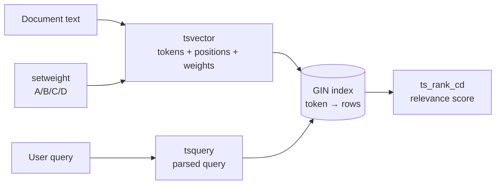
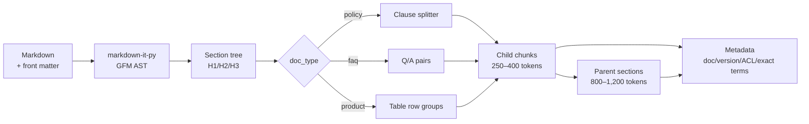
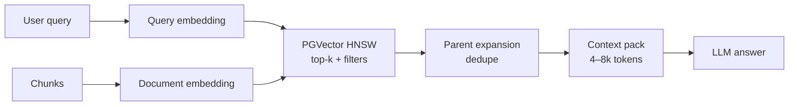
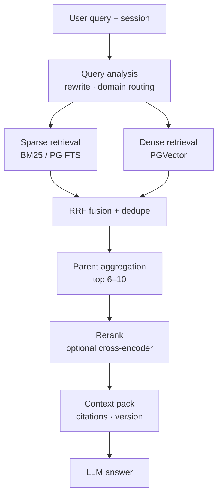
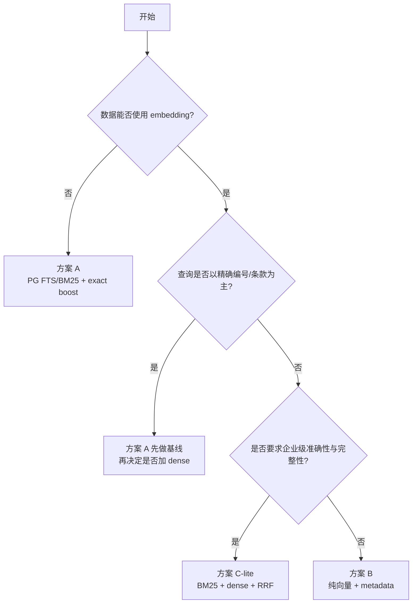

# 银行业企业知识库 RAG 方案讨论报告

> **副标题**：方案 A（倒排索引）/ 方案 B（向量检索）/ 方案 C（混合检索）的取舍与实施路径  
> **文档性质**：方案讨论稿（Decision Draft），不含生产实现  
> **日期**：2026-11-08  
> **适用工程**：`adk-rag/`  
> **关联文档**：[Research.md](Research.md)（详细调研与推导）  
> **前提**：知识文档为 **英文 Markdown**；本文不讨论中文分词、中文 FTS 扩展等问题。

---

## 0. 摘要

按 [Research.md](Research.md) 当前记录，知识库规模约 **35 万字符、约 1,100 个 chunk**；未来 5 → 20 个业务域。英文场景下，三种方案的工程难度都比中文场景低：PostgreSQL 自带 `english` 全文检索配置，不需要 `zhparser`/`jieba` 等扩展。

**结论：**

| 方案 | 定位 | 建议 |
|---|---|---|
| **A. 倒排索引（FTS/BM25）** | 精确词项召回、低成本基线 | **先做基线；可作为降级通道** |
| **B. Embedding 向量检索** | 语义召回 | **作为 C 的召回通道；不建议单独作为最终架构** |
| **C. 混合检索** | BM25 + dense + RRF + 重排 | **企业级 POC 推荐；先做 C-lite** |

**推荐路径：**

1. 用同一套**结构感知分块 + 元数据**，同时产出 BM25 索引和向量索引；
2. POC 先做 **C-lite**：BM25 + dense + RRF + 父子块扩展 + 启发式重排；
3. 用金标集证明 C-lite 相对 A 的增益，再决定是否加 cross-encoder；
4. 如果数据合规不允许 embedding，A + 好的分块/字段权重/重排仍是可用的降级方案。

**关键数字（POC 目标，需实测校准）：**

- 检索 p95 < 200 ms；
- RAG 端到端 p95 ≤ 8 s，硬上限 10 s；
- 每轮证据 4–8k tokens；
- 当前 1,100 chunks 的向量存储约 4.5 MB（1024 维 float32），PGVector 单机绰绰有余；
- 即使未来 20 域 × 2 MB，约 3–4 万 chunks，单机 PG 仍足够。

### 0.1 术语速查：FTS / C-lite / tsvector / GIN / setweight / ts_rank_cd

这几个词经常被混在一起，其实分属两个层面：

- **FTS、tsvector、GIN、setweight、ts_rank_cd**：PostgreSQL 全文检索的**实现机制**；
- **C-lite**：一种**检索架构**，它把 FTS/BM25 当作其中一路召回通道。

| 术语 | 全称 | 一句话解释 | 在本报告中的位置 |
|---|---|---|---|
| **FTS** | Full-Text Search | 全文检索：把文本解析成词条、词干和位置，支持短语/布尔查询并排序；不是 `LIKE '%keyword%'` | 方案 A 的主实现 |
| **C-lite** | Hybrid Retrieval Lite | 混合检索的轻量版：sparse + dense + RRF + 父子块 + 启发式重排；不含 cross-encoder/LLM 路由/多轮纠正 | 方案 C 的 POC 起点 |
| **tsvector** | Text Search Vector | PostgreSQL 数据类型：文档经过解析、归一化、词干化后的「词条 + 位置 + 权重」列表 | `chunk.tsv` 列 |
| **GIN** | Generalized Inverted Index | PostgreSQL 的倒排索引类型：`词条 → 包含它的行`；让 `tsv @@ query` 查找很快 | `chunk_tsv_gin` 索引 |
| **setweight** | — | 给 `tsvector` 的不同部分打 A/B/C/D 权重；标题/章节 A、正文 B；只影响排序，不影响是否命中 | 标题/正文加权 |
| **ts_rank_cd** | Text Rank Cover Density | PostgreSQL 的排序函数：根据命中词、词之间距离和权重算相关性分数；**不是 BM25** | A 的默认排序 |
| **tsquery** | Text Search Query | 查询解析后的结构，如 `'early' & 'withdraw'`；`websearch_to_tsquery` 负责把用户输入转成它 | 查询侧 |

**它们如何串起来：**



用一个英文例子：

```text
文档标题：Early Withdrawal Policy
正文：Early withdrawal of a CD requires ...

to_tsvector('english', title)   → 'earli':1 'withdraw':2 'polici':3
setweight(..., 'A')             → 'earli':1A 'withdraw':2A 'polici':3A
setweight(body, 'B')            → 'earli':5B 'withdraw':6B ...

用户查询：early withdrawal
websearch_to_tsquery('english', ...) → 'earli' & 'withdraw'

GIN 找到包含这些词的行 → ts_rank_cd 结合权重/距离算分
```

**最容易混淆的三点：**

1. **FTS ≠ BM25**：FTS 是「全文检索机制」，BM25 是「一种排序公式」。PostgreSQL 的 `ts_rank_cd` 不是 BM25；如果团队明确要求 BM25，需要用 `rank_bm25`/`bm25s`、`pg_search` 或 Elasticsearch/OpenSearch。
2. **`tsvector` ≠ 原文**：它是处理后的词条索引表示，不能拿来当原文返回；原文仍在 `chunk.text`。
3. **C-lite ≠ FTS**：C-lite 是「混合检索架构」，FTS 只是它的 sparse 通道；C-lite 还包含 dense 通道、RRF 融合和父子块。

> 补充：`ts_rank_cd(tsv, query, 32)` 里的 `32` 是 **normalization flag**，不是分数阈值；它控制排序分数如何按文档长度/排名归一化。常用 0/1/2/4/8/16/32 或组合，按评估调。

---

## 1. 场景、约束与规模

### 1.1 业务域与示例问题

| 域 ID | 业务域 | 典型内容 |
|---|---|---|
| `aml` | AML / KYC | customer due diligence, beneficial ownership, screening |
| `deposit` | Deposits & CDs | product rules, early withdrawal, interest, required documents |
| `fx` | Cross-border Payments & FX | remittance, FX reporting, supporting documents |
| `credit` | Retail Lending | eligibility, limits, rates, post-loan management |
| `wealth` | Wealth Management | risk rating, suitability, disclosure |

贯穿全文的英文示例：

| 编号 | 问题 | 考验 |
|---|---|---|
| Q1 | What documents are required for early withdrawal of a large-denomination CD opened by a foreign customer? | cross-domain + completeness |
| Q2 | What if an authorized representative handles it? | follow-up + coreference |
| Q3 | A foreign customer uses an offshore account to buy a CD and withdraws early — what KYC and FX reporting obligations apply? | cross-domain merge |
| Q4 | What does Circular [2022] No. 5 require for early withdrawal of large-denomination CDs? | exact identifier |
| Q5 | What is the difference between early redemption and early withdrawal? | paraphrase/comparison |

Q4 是 A 的强项、B 的弱项；Q5 是 B 的强项、A 的弱项；Q1/Q3 两者都需要。这是推荐 C 的根本原因。

### 1.2 技术栈与约束

| 层 | 当前企业 Agent | 本 POC |
|---|---|---|
| 编排 | Google ADK | Google ADK 2.x |
| 回答模型 | Gemini 3.5 Flash | DeepSeek / Gemini |
| Embedding | google-embedding-01 | qwen3.7-text-embedding-flash |
| 向量库 | PGVector | 本地 Docker PGVector |
| 知识形态 | 5 个业务域，Markdown | 同左，未来 20 个域 |

| 约束 | 说明 | 对方案的影响 |
|---|---|---|
| 延迟 | RAG 端到端额外负担 ≤ 10 s；目标 p95 ≤ 8 s | 检索必须 < 1 s；重排可裁剪 |
| Token | 现有 Agent 已有长上下文；每轮证据 4–8k tokens | 不能整篇注入；必须 top-k + 父级扩展 |
| 准确性 | 文号/产品代码/金额/日期不能错 | A 的 exact 字段、C 的融合与引用校验 |
| 完整性 | 列举/流程题不能漏项 | 父子块、按问题类型调 top-k |
| 更新 | 内容频繁变更，不能因知识更新发应用版 | 独立 ingest + 原子批次 |
| 扩展 | 5 → 20 域，不能每域一套代码 | 域目录数据驱动 |
| 安全 | ACL、审计、数据出境、Prompt Injection | 检索时硬过滤；证据当数据 |

### 1.3 规模：不是向量规模问题

按 [Research.md](Research.md) 当前记录约 **35 万字符 / 1,100 chunks**：

| 项 | 估算 |
|---|---:|
| 原始文本 | ~350k chars |
| chunk 数（现有切分，平均 ~320 chars/chunk） | ~1,100 |
| 向量存储（1024 维 float32） | ~4.5 MB |
| HNSW 索引 | ~7–10 MB |
| BM25 索引 | 几 MB–几十 MB |
| 全量重建 | 秒级–分钟级 |

> 如果按本报告建议的 250–400 tokens 重新分块，chunk 数会变化：当前 1,100 是现有切分（平均约 320 chars/chunk）下的数量；按 300 tokens/块重新切，会降到几百个。无论哪种，规模都很小，不影响结论。

即使未来 20 域 × 2 MB（约 40 MB 文本），按 300 tokens/块估算也只有约 **3–4 万 chunks**，单机 PostgreSQL + PGVector 足够。

**结论：瓶颈不是索引规模，而是分块质量、路由、版本/权限、评估和延迟控制。**

### 1.4 评价标准

| 维度 | 指标 | POC 门槛 |
|---|---|---|
| 检索 | Recall@10 | ≥ 0.85，或较 A 基线 +20% |
| 检索 | nDCG@10 | ≥ 0.75 |
| 精确 | 文号/产品代码命中率 | ≥ 0.95 |
| 完整性 | 列举/流程题要点覆盖 | ≥ 0.85 |
| 生成 | faithfulness | ≥ 0.90 |
| 生成 | citation accuracy | ≥ 0.95 |
| 性能 | 检索 p95 | < 200 ms |
| 性能 | 端到端 p95 | ≤ 8 s（硬上限 10 s） |
| 安全 | ACL 越权 / 过期版本 | 0 |

---

## 2. 方案 A/B/C 一页对比

**定义：**

- **A = 稀疏检索**：倒排索引；排名可用 PG FTS `ts_rank_cd`，也可以用严格 BM25。
- **B = 稠密检索**：embedding + 向量索引（PGVector/HNSW）。
- **C = 混合检索**：A + B 双通道召回，RRF 融合，按需重排。

| 维度 | A 倒排 | B 向量 | C 混合 |
|---|---:|---:|---:|
| 语义召回（换说法） | 2 | 5 | 5 |
| 精确编号/产品代码/数字 | 5 | 2 | 5 |
| 英文词形/同义处理 | 3 | 5 | 5 |
| 列举/完整性 | 3 | 3 | 5 |
| 查询延迟 | 5 | 4 | 3 |
| Token 效率 | 3 | 4 | 5 |
| 更新/新鲜度 | 5 | 3 | 3 |
| 运维复杂度（5=简单） | 5 | 4 | 3 |
| 可解释性 | 5 | 2 | 4 |
| 数据不出内网的灵活性 | 5 | 2 | 3 |
| 整体准确性 | 3 | 3 | 5 |
| 适合的角色 | 基线/降级 | 召回通道 | **推荐架构** |

> 评分为定性 1–5，用于建立直觉；最终选型以金标集实测为准。

**一句话：**

- **A 不是“落后方案”**：英文场景下 PostgreSQL `english` FTS 很成熟，A 是极好的基线和降级通道。
- **B 不是“完整方案”**：它擅长“可能相关”，不擅长“精确正确”；没有 metadata/exact/rerank 时，前排不可靠。
- **C 不是“为了高级”**：它是对 A/B 失败模式互补的对冲；代价是复杂度和评估成本。

**实施成本（不含共用分块）：**

| 方案 | 新增组件 | 预计 POC 工作量 | 主要风险 |
|---|---|---|---|
| A | PG FTS + `exact_terms` GIN | 2–3 天 | 词汇鸿沟、列举漏项 |
| B | embedding API + PGVector/HNSW | 3–5 天 | 精确 ID、数据出境、模型漂移 |
| C | A + B + RRF + 可选 rerank | 5–8 天 | 复杂度、参数调优、延迟 |

---

## 3. 共同基础：分块与元数据

A/B/C 共用同一套分块和 `chunk_id`，差异只在“建什么索引、怎么查”。这样 A 的索引不会白做，C 可以直接复用。

### 3.1 英文分块原则

- **按结构切，不按固定长度切**：H1/H2/H3、条款、表格、列表。
- **child 用于检索，parent 用于生成**：
  - child：250–400 tokens（约 1,000–1,600 字符）；
  - parent：800–1,200 tokens；
  - overlap：10–15%，只在句子/条款边界。
- **表格**：表头 + 行组；每组重复表头；可转成 `column=value` 文本，提升 BM25 命中。
- **列表/条款**：保留编号和引导句；长列表按 5–8 项分组，重复引导句。
- **FAQ**：一个问题 + 一个答案作为一个 chunk，不拆开。
- **英文 tokenization**：
  - NFKC、小写、标点/空白归一化；
  - BM25/FTS 用 stemming（Snowball/Porter）处理 `withdraw/withdrawal`；
  - **不要去掉否定/限定词**：`not`, `no`, `except`, `unless`, `only`, `without`；
  - 文号/产品代码/金额/日期放 `exact_terms`，**不要 stem**。

> **English FTS 的否定词陷阱**：PostgreSQL `english` 配置自带 stopword 列表，可能把 `not`/`no` 等词去掉；如果这些词在业务里重要，建议创建自定义 stopword 字典保留它们。注意：BM25/FTS 即使保留 `not`，也只是把它当普通词，并不等于逻辑否定；真正的否定/例外判断仍要交给重排或 LLM。

### 3.2 分块流水线



### 3.3 每个 chunk 的元数据

```json
{
  "chunk_id": "deposit-cd-001@3.2#h2-3#c02#a1b2c3d4",
  "domain_id": "deposit",
  "doc_id": "deposit-cd-001",
  "doc_version": "3.2",
  "doc_type": "policy",
  "section_id": "deposit-cd-001@3.2#h2-3",
  "parent_id": "deposit-cd-001@3.2#h2-3",
  "heading_path": "Large-Denomination CD Policy > 3 Early Withdrawal > 3.2 Authorized Representative",
  "text": "...",
  "token_count": 286,
  "content_hash": "sha256:...",
  "chunker_version": "md-struct-v1",
  "status": "active",
  "effective_from": "2026-01-01",
  "effective_to": null,
  "acl_groups": ["role:retail_business"],
  "exact_terms": ["Circular [2022] No. 5", "USD 100,000"],
  "source_start": 1834,
  "source_end": 2410
}
```

### 3.4 质量检查

- 空块/只有标题的块；
- 超长块；
- 表格块是否带表头；
- 条款编号是否连续；
- 列表是否丢失引导句；
- 同一文档内重复 chunk；
- token 数是否超过索引/模型上限；
- front matter 是否缺字段。

不通过的文档进隔离区，不进入 active 批次。

### 3.5 推荐工具清单

| 任务 | 推荐工具 | 说明 |
|---|---|---|
| Markdown 解析 | `markdown-it-py` | GFM AST + `token.map` 行号 |
| front matter | `python-frontmatter` | 读取 `doc_id/version/status/ACL` |
| PG 访问 | `psycopg`（v3）或 `asyncpg` | 异步/同步均可；参数化查询 |
| A 主索引 | PostgreSQL `tsvector` + GIN | 内置，无需额外搜索引擎 |
| A 严格 BM25 | `rank_bm25` 或 `bm25s` | 应用侧 BM25；`bm25s` 更快、可持久化 |
| B 向量 | `pgvector`（Python 包） | 写入/查询 `vector(n)` |
| B embedding | qwen / google SDK | 批量、重试、维度/前缀确认 |
| C 重排 | `sentence-transformers` `CrossEncoder` | 英文可用 `ms-marco-MiniLM` 等 |
| 评估 | `pytest` + 自定义 harness | Recall@k/nDCG/延迟 |
| 代码质量 | `ruff` / `mypy` | 可选，但建议 |

> 不要为了“技术栈完整”引入 Elasticsearch；当前 1,100 chunks，PG FTS + PGVector 足够。等 chunk 数到百万级或 QPS 明显上来，再考虑 ES/OpenSearch。

---

## 4. 方案 A：倒排索引

> 本节涉及的 FTS / tsvector / GIN / setweight / ts_rank_cd，已在 **0.1 术语速查**中解释；下面只讲怎么用。  
> 可直接用于新会话实现的详细执行计划见 [方案A实施计划.md](方案A实施计划.md)。

### 4.1 思路


### 4.2 具体实施

| 步骤 | 动作 | 产出 |
|---|---|---|
| A1 | Markdown 结构分块（共用第 3 章） | child/parent + metadata |
| A2 | 建 PG FTS：`tsvector` + GIN，`english` 配置 | `chunk.tsv` + GIN |
| A3 | 字段权重：heading A / body B；`setweight` | 排序更合理 |
| A4 | 建 `exact_terms` GIN；文号/代码/金额/日期 | 精确命中 boost |
| A5 | 查询：`websearch_to_tsquery('english', ...)` + `ts_rank_cd` | top-k |
| A6 | 父级聚合 + 版本/ACL 过滤 + 缓存 | 6–10 个父块 |

**索引定义（PostgreSQL）：**

> 下面只列 A 需要的列；与 B/C 共用时，使用附录 A 的完整 schema，避免重复建表。

```sql
CREATE TABLE chunk (
  id               text PRIMARY KEY,
  domain_id        text NOT NULL,
  doc_id           text NOT NULL,
  doc_version      text NOT NULL,
  doc_type         text NOT NULL,
  section_id       text NOT NULL,
  parent_id        text,
  heading_path     text NOT NULL,
  text             text NOT NULL,
  token_count      int NOT NULL,
  status           text NOT NULL,
  effective_from   date,
  effective_to     date,
  acl_groups       text[] NOT NULL DEFAULT '{}',
  exact_terms      text[] NOT NULL DEFAULT '{}',
  content_hash     text NOT NULL,
  chunker_version  text NOT NULL,
  batch_id         bigint NOT NULL,
  source_start     int,
  source_end       int,
  tsv              tsvector
);

CREATE OR REPLACE FUNCTION update_chunk_tsv() RETURNS trigger AS $$
BEGIN
  NEW.tsv :=
    setweight(to_tsvector('english', coalesce(NEW.heading_path, '')), 'A') ||
    setweight(to_tsvector('english', coalesce(NEW.text, '')), 'B');
  RETURN NEW;
END
$$ LANGUAGE plpgsql;

CREATE TRIGGER trg_chunk_tsv
BEFORE INSERT OR UPDATE OF heading_path, text ON chunk
FOR EACH ROW EXECUTE FUNCTION update_chunk_tsv();

CREATE INDEX chunk_tsv_gin ON chunk USING gin (tsv);
CREATE INDEX chunk_exact_gin ON chunk USING gin (exact_terms);
CREATE INDEX chunk_filter_btree
  ON chunk (domain_id, status, effective_from, effective_to);
CREATE INDEX chunk_acl_gin ON chunk USING gin (acl_groups);
```

**查询：**

```sql
WITH q AS (
  SELECT websearch_to_tsquery('english', $1) AS query
)
SELECT c.id, c.parent_id, c.heading_path, c.text,
       ts_rank_cd(c.tsv, q.query, 32) AS score
FROM chunk c, q
WHERE c.tsv @@ q.query
  AND c.domain_id = ANY($2)
  AND c.status = 'active'
  AND (c.effective_from IS NULL OR c.effective_from <= $3)
  AND (c.effective_to IS NULL OR c.effective_to > $3)
  AND c.acl_groups && $4
ORDER BY score DESC
LIMIT 80;
```

**精确词通道（与 FTS 并行/融合）：**

```sql
SELECT id, parent_id, 1.0 AS score
FROM chunk
WHERE exact_terms && ARRAY[$1]
  AND domain_id = ANY($2)
  AND status = 'active'
LIMIT 20;
```

> `ts_rank_cd` 不是 BM25；它使用 cover density + 字段权重。英文场景下通常够用；如果团队明确要求严格 BM25，见 4.4。

### 4.3 优点与缺点

**优点：**

- 英文场景零额外扩展：PG 自带 `english` parser/stemmer；
- 精确文号、产品代码、金额、日期强；
- 快：1,100 chunks 查询通常 < 50 ms；
- 可解释：能打印命中词、字段、分数；
- 更新简单：trigger 维护 `tsv`，GIN 自动更新；
- 无 embedding 依赖，数据不出内网更容易；
- 是 C 的天然基线和降级通道。

**缺点：**

- 词汇鸿沟：用户说 `early redemption`，文档写 `early withdrawal`，没有共享词就漏；
- 语义/否定/条件弱：`except`, `unless`, `not applicable` 可能排错；
- 完整性一般：列举题只召回部分 section；
- 同义词表要维护；
- `ts_rank_cd` 不是 BM25；排序质量依赖字段权重和 exact boost。

**适用：**

- 查询以精确查找为主；
- 合规不允许 embedding/外部模型；
- 作为 POC 第一周的基线；
- 作为 C 的降级通道（embedding 服务故障时）。

**严格 BM25 的替代：**

- 应用侧 `rank_bm25` / `bm25s` + 英文 tokenizer/stemmer；
- ParadeDB `pg_search`（Postgres 内 BM25）；
- Elasticsearch/OpenSearch（英文 BM25 最成熟，但多一个服务）。

### 4.4 严格 BM25 的实现（可选）

如果团队明确要求 BM25，而不是 `ts_rank_cd`：

```python
import re
from rank_bm25 import BM25Okapi
from nltk.stem import PorterStemmer

stemmer = PorterStemmer()

def tokenize(text: str) -> list[str]:
    text = text.lower()
    words = re.findall(r"[a-z0-9][a-z0-9._-]*", text)
    # 不要过滤 not/no/except/unless/only/without
    return [stemmer.stem(w) for w in words]

corpus_tokens = [tokenize(c.text) for c in chunks]
bm25 = BM25Okapi(corpus_tokens, k1=1.5, b=0.75)

q_tokens = tokenize(normalized_query)
scores = bm25.get_scores(q_tokens)
```

要点：

- 索引/查询必须使用同一 tokenizer + stemmer；
- 按域建索引，按 `batch_id` 版本化；
- 持久化用 `pickle`（`rank_bm25`）或 `bm25s` 的 `save()`；
- 只加载 token/postings，不加载原文；命中后按 ACL 从 PG 取文本；
- 精确文号/产品代码仍走 `exact_terms`，不要依赖 BM25；
- 多实例各自加载同一版本，更新时原子 reload。

> 如果不想维护应用侧索引，直接上 PG FTS；如果想要单库 BM25，评估 ParadeDB `pg_search`；如果规模上百万，ES/OpenSearch。

### 4.5 Tantivy / Whoosh 能否替代 PG FTS？

**可以，但它们替代的是「索引 + 排序」层，不是整套 RAG。**

| 方案 | 索引维护 | BM25 | 元数据/ACL | 更新/原子性 | 运维 | 适用 |
|---|---|---|---|---|---|---|
| **PG FTS** | trigger + GIN 自动维护 | 否，`ts_rank_cd` | SQL 直接过滤 | 事务/批次 | 低 | 默认方案 |
| **Tantivy（tantivy-py）** | 手动 commit/reload/merge | 是 | 存字段/后置过滤 | 需自己设计 | 中 | 嵌入式 BM25 |
| **Whoosh-reloaded** | 手动 commit/reload | 是（BM25/BM25F） | 存字段/后置过滤 | 需自己设计 | 中 | 原型/离线 |
| **rank_bm25 / bm25s** | 启动时构建/更新时重建 | 是 | 应用层过滤 | 需自己设计 | 低 | POC 基线 |
| **ParadeDB pg_search** | 扩展维护 | 是 | SQL 直接过滤 | 事务/批次 | 低–中 | 单库 BM25 |

#### 自动化程度

- **PG FTS：数据库层自动，业务层手工。**
  - 一次性手工：建表、`CREATE INDEX`、trigger 函数；
  - 之后自动：`INSERT/UPDATE` 触发 `tsv` 更新，GIN 自动维护；
  - 仍需手工/脚本：文档发现、解析、分块、metadata、`exact_terms`、批次切换、回滚、评估。
- **Tantivy / Whoosh：没有 trigger，索引生命周期要自己管。**
  - 需要自己写：schema、`add_document`、`commit`、`reload`、删除/更新、段合并、版本化目录、原子切换；
  - 适合「PG 存 chunk 和 metadata，Tantivy/Whoosh 只存 `chunk_id + searchable text`，查询返回 ID 后回 PG 取文本/ACL」的架构；
  - 多实例要各自 reload，或者共享索引目录 + 版本号。

#### 需要手工定制的部分

| 环节 | 谁来做 | 说明 |
|---|---|---|
| 表结构 / GIN / trigger | 手工一次 | migration + DDL |
| 文档发现、解析、分块 | 自定义 pipeline | `markdown-it-py` + 条款/表格规则 |
| 英文 tokenizer/stemmer/stopwords | 配置/自定义 | PG `english` 或应用侧 tokenizer |
| `exact_terms` 提取 | 自定义正则 | 文号/产品代码/金额/日期 |
| 字段权重 | 调参 | heading A / body B |
| 查询归一化/同义词 | 自定义 | query 侧，不是索引侧 |
| ACL / 版本 / 批次 | 自定义 | SQL 过滤 + active_batch |
| `tsv` 更新 / GIN 维护 | 自动 | trigger + PostgreSQL |
| 缓存 / 回滚 / 评估 | 自定义 | 运维与评估流程 |

#### 主要替代哪些环节

**替代：**

- `tsvector` / GIN 的倒排存储与查找；
- `ts_rank_cd`（或应用侧 BM25）的排序；
- 部分 query parser/analyzer（Tantivy 的 `QueryParser`、Whoosh 的 `QueryParser`）。

**不替代：**

- Markdown 解析、结构分块、父子块；
- metadata / 版本 / ACL / 批次；
- 与 dense 的 RRF 融合、cross-encoder 重排；
- context packing、引用校验、评估、ADK 集成。

#### 选择建议

- **当前 1,100 chunks：优先 PG FTS。** 查询 < 50 ms，GIN/trigger 自动维护，少一个索引系统。
- **需要严格 BM25 + 嵌入式索引：选 Tantivy。** 比 Whoosh 快，BM25/倒排能力更接近 Lucene；代价是要自己管 commit/reload/版本。
- **Whoosh-reloaded：适合原型/离线评估。** 纯 Python 上手快，但性能和生态不如 Tantivy；不建议作为高并发生产首选。
- **想留在 PG 内用 BM25：评估 ParadeDB `pg_search`。** 少一个索引系统，事务/ACL 仍在 SQL 里。
- **规模上百万或需要成熟中文/多语言分析：Elasticsearch/OpenSearch。**

> 一句话：Tantivy/Whoosh 可以替换「倒排索引 + BM25 排序」，但不能替换「分块、元数据、权限、更新、融合」；如果只是想要 BM25，先用 `rank_bm25`/`bm25s` 或 `pg_search`，不一定要引入新的索引系统。

---

## 5. 方案 B：Embedding 向量检索

### 5.1 思路



### 5.2 具体实施

| 步骤 | 动作 | 产出 |
|---|---|---|
| B1 | 共用第 3 章分块 | chunk + metadata |
| B2 | 调 embedding 模型（qwen3.7-text-embedding-flash / google-embedding-01） | `vector(n)` |
| B3 | 归一化/前缀/批量/重试 | 稳定向量 |
| B4 | 建 HNSW（或当前规模先精确扫描） | ANN 索引 |
| B5 | 查询 embedding + metadata filter | top-k |
| B6 | 父级扩展 + 版本/ACL + 缓存 | 证据包 |

**索引定义：**

```sql
CREATE EXTENSION IF NOT EXISTS vector;

-- 附录 A 的共用 schema 已预留 embedding / embedding_model 列；
-- 若单独建 B 表，再 ALTER TABLE chunk ADD COLUMN embedding vector(1024);
-- 维度按实际模型替换；HNSW 对 vector 最多 2,000 维，halfvec 最多 4,000 维

-- 当前 1,100 chunks：精确扫描可能已经足够；数据量上来再建 HNSW
CREATE INDEX chunk_embedding_hnsw ON chunk
USING hnsw (embedding vector_cosine_ops)
WITH (m = 16, ef_construction = 64);
```

> 以上 DDL 以附录 A 的共用 schema 为前提；A-only 实现可以省略 `embedding` 列。

**查询：**

```sql
SELECT c.id, c.parent_id, c.heading_path, c.text,
       1 - (c.embedding <=> $1) AS score
FROM chunk c
WHERE c.domain_id = ANY($2)
  AND c.status = 'active'
  AND (c.effective_from IS NULL OR c.effective_from <= $3)
  AND (c.effective_to IS NULL OR c.effective_to > $3)
  AND c.acl_groups && $4
ORDER BY c.embedding <=> $1
LIMIT 40;
```

### 5.3 优点与缺点

**优点：**

- 语义召回强：换说法、同义、自然语言问法；
- 英文 embedding 成熟，跨表达泛化好；
- 查询链路简单：一次 embedding + 一次 ANN；
- 不需要维护同义词表；
- 当前规模向量存储只有 ~4.5 MB，成本极低。

**缺点：**

- 精确编号/数字/否定弱；
- 相似 ≠ 正确：可能召回语义相近但适用条件不同的条款；
- 版本/权限必须靠 metadata filter；
- 分块边界会切断条款/表格；
- 换模型要全量重建；
- 可解释性低；
- API embedding 有数据出境/合规问题。

**适用：**

- 查询以自然语言、FAQ、解释型问题为主；
- 精确编号/数字很少；
- 合规允许 embedding API 或已有本地 embedding；
- 作为 C 的召回通道，而非完整方案。

---

## 6. 方案 C：混合检索

> C-lite / C-full 的定义见 **0.1 术语速查**和 6.2 节；C-lite 不是数据库特性，而是一种检索架构。

### 6.1 思路



### 6.2 C-lite 与 C-full

| 版本 | 组成 | 适用 |
|---|---|---|
| **C-lite（POC 起点）** | BM25 + dense + RRF + 父子块 + 启发式重排 | 先证明混合检索有增益 |
| **C-full** | C-lite + cross-encoder 重排 + LLM 查询分析/路由 + 最多一轮 corrective retrieval | 金标集显示精度/完整性仍不足 |

### 6.3 具体实施

| 步骤 | 动作 | 产出 |
|---|---|---|
| C1 | 复用 A 的稀疏索引（PG FTS/BM25）和 B 的向量索引 | 同一 `chunk_id` |
| C2 | 查询分析：英文同义词/缩写、追问改写、域路由 | QueryPlan |
| C3 | 并行召回：BM25 top 40 + dense top 40 | 两路候选 |
| C4 | RRF 融合 + 去重 + 父级聚合 | 8–10 个父块 |
| C5 | 可选 cross-encoder：top 20–30 → top 8 | 精排 |
| C6 | 上下文装配：4–8k tokens + 引用 + 版本 | EvidencePack |
| C7 | 引用校验/弃答；记录路由、分数、延迟 | 回答 + 审计 |

跨域/多轮补充：

- 会话状态保存 `active_domains`、`last_query`、`last_citations`；
- 跨域按域并行检索，每域配额（如最多 4 块），避免单域淹没；
- 追问沿用上一轮域；显式切换域时重置；
- 精确通道：A 的 `exact_terms` 与 FTS 并行，命中时提高权重（RRF 或加权）；
- 所有通道都必须带 `status`/`effective date`/ACL 过滤，不能只靠后置过滤。

**RRF：**

```text
RRF(d) = Σ_r w_r / (k + rank_r(d))
k = 60；w_sparse = 1.0；w_dense = 1.0
```

### 6.4 优点与缺点

**优点：**

- 同时覆盖精确词项和语义表达；
- 列举/完整性可通过父级扩展和多查询改善；
- 比 A/B 单方案更稳，坏 case 更少；
- A/B 索引可复用，C 的增量成本主要是融合/重排；
- 当前规模检索总耗时通常 < 1 s，远低于 10 s 预算。

**缺点：**

- 两套索引、两套更新链路；
- 参数更多（top-k、RRF 权重、重排阈值）；
- 延迟高于 A/B；
- 评估成本更高；
- 需要 cross-encoder/rerank 时增加模型依赖。

**适用：**

- 企业级 POC，要求准确性与完整性；
- 查询混合了精确编号和自然语言；
- 有金标集和评估能力；
- 能接受比 A 多 200–500 ms 的检索延迟。

---

## 7. 选型建议



**我的建议：**

1. **A 必须做**：它是基线，也是降级通道；英文 PG FTS 成本很低。
2. **B 作为组件**：不要单独上 B；把向量当召回通道。
3. **C-lite 作为 POC 目标**：用金标集证明 C-lite 相对 A 有增益；如果无增益，停在 A。
4. **C-full 最后加**：只有 C-lite 的 precision 不够时，才加 cross-encoder。

**例外：**

- 如果 80% 以上查询是文号/产品代码/条款号，A 可能已经足够；
- 如果数据合规禁止 embedding，A + 字段权重 + exact boost 是现实方案；
- 如果查询以自然语言 FAQ 为主，B 可以作为起点，但仍建议保留 exact 字段。

---

## 8. POC 实施计划

### 8.1 阶段

| 阶段 | 时间（1 人） | 目标 | 交付物 |
|---|---:|---|---|
| Phase 0 | 2–3 天 | 语料审计、60 条英文金标、A 基线 | 评估集 + BM25 报告 |
| Phase 1 | 3–5 天 | 结构分块 + PG FTS；跑通 A | A 的 Recall@10/p95 |
| Phase 2 | 3–5 天 | B 的向量索引；A/B 对比 | B 报告 |
| Phase 3 | 4–6 天 | C-lite：RRF + 父级 + 路由 | C 报告 + demo |
| Phase 4 | 3–5 天 | 更新/回滚/观测/文档 | runbook + 决策记录 |

总计约 **3 周**（1 名工程师 + 兼职 SME）。

### 8.2 消融实验

| 实验 | 组成 | 目的 |
|---|---|---|
| A | BM25 / PG FTS | 基线 |
| B | dense only | 向量基线 |
| C1 | BM25 + dense + RRF | 混合召回 |
| C2 | C1 + 父级扩展 | 完整性 |
| C3 | C2 + 启发式重排 | 排序 |
| C4 | C3 + cross-encoder | 精度上限 |

每轮记录 Recall@5/10/20、nDCG@10、精确命中率、p95、tokens/请求。

### 8.3 验收

| 指标 | 目标 |
|---|---|
| Recall@10 | ≥ 0.85 或较 A +20% |
| exact ID hit | ≥ 0.95 |
| 列举/流程覆盖 | ≥ 0.85 |
| 检索 p95 | < 200 ms |
| 端到端 p95 | ≤ 8 s |
| citation accuracy | ≥ 0.95 |
| ACL 越权/过期版本 | 0 |
| 更新不发版；回滚 | < 5 min |

> 如果 C1 相对 A 没有显著增益，先查分块/评估集，不要急着加 C2/C3。

---

## 9. 风险与待确认

| 风险 | 影响 | 缓解 |
|---|---|---|
| Embedding 数据出境 | 方案 B/C 不可用 | Phase 0 确认合规；准备 A 降级 |
| 精确 ID 被向量淹没 | 文号/代码答错 | `exact_terms` + A 通道 |
| 分块切断条款/表格 | 完整性差 | 结构分块 + 父级扩展 |
| 版本/权限过滤遗漏 | 合规事故 | SQL 硬过滤 + 测试 |
| RRF/重排参数过拟合 | 线上不稳 | 固定金标集 + 分域 breakdown |
| 评估集太小 | 结论不可信 | 60 条起步，逐步扩到 125 |
| PG FTS `ts_rank_cd` 不够好 | A 的排序差 | 换 `rank_bm25`/`pg_search`/ES |

**需要确认：**

1. Embedding 是否允许出内网？决定 B/C 是否可行。
2. 查询中精确编号/产品代码占比多少？决定 A 是否足够。
3. 现有 Agent 是 ADK `LlmAgent` 还是 `Workflow`？决定集成方式。
4. 文档是否只有英文 Markdown？未来是否有 PDF/DOCX？
5. ACL 粒度是域级、文档级还是字段级？

---

## 附录 A：A/B/C 共用 Schema（简化）

```sql
CREATE TABLE chunk (
  id               text PRIMARY KEY,
  domain_id        text NOT NULL,
  doc_id           text NOT NULL,
  doc_version      text NOT NULL,
  doc_type         text NOT NULL,
  section_id       text NOT NULL,
  parent_id        text,
  heading_path     text NOT NULL,
  text             text NOT NULL,
  token_count      int NOT NULL,
  status           text NOT NULL,
  effective_from   date,
  effective_to     date,
  acl_groups       text[] NOT NULL DEFAULT '{}',
  exact_terms      text[] NOT NULL DEFAULT '{}',
  content_hash     text NOT NULL,
  chunker_version  text NOT NULL,
  batch_id         bigint NOT NULL,
  source_start     int,
  source_end       int,
  embedding_model  text,
  embedding        vector(1024),
  tsv              tsvector
);
```

## 附录 B：RRF 与指标

```text
RRF(d) = Σ_r w_r / (k + rank_r(d))
k = 60

Recall@k = |relevant ∩ top_k| / |relevant|
MRR@k = (1/|Q|) Σ 1/rank_q
nDCG@k = DCG@k / IDCG@k
DCG@k = Σ rel_i / log2(i+1)
```

## 附录 C：术语

| 术语 | 解释 |
|---|---|
| BM25 | 词项匹配排序算法，考虑 TF/IDF/长度归一化 |
| FTS | Full-Text Search，全文检索机制；不是单个函数，也不等于 BM25 |
| tsvector | PostgreSQL 的文档词条表示：词条 + 位置 + 权重 |
| GIN | Generalized Inverted Index，PostgreSQL 的倒排索引类型 |
| setweight | 给 `tsvector` 的字段打 A/B/C/D 权重，影响排序 |
| ts_rank_cd | PostgreSQL 的 cover-density 排序函数；不是 BM25 |
| tsquery | 查询解析后的结构，如 `'early' & 'withdraw'` |
| C-lite | 混合检索轻量版：sparse + dense + RRF + 父子块 + 启发式重排 |
| C-full | C-lite + cross-encoder + LLM 路由/纠正性检索 |
| HNSW | 近似最近邻向量索引 |
| RRF | 按排名融合多路检索结果 |
| Cross-encoder | 对 query+passage 联合打分的小模型 |
| Parent-child | 子块检索、父块补全上下文 |
| ACL | 访问控制列表 |

## 附录 D：参考

- PostgreSQL Full Text Search: <https://www.postgresql.org/docs/current/textsearch.html>
- pgvector: <https://github.com/pgvector/pgvector>
- markdown-it-py: <https://github.com/executablebooks/markdown-it-py>
- rank_bm25: <https://github.com/dorianbrown/rank_bm25>
- bm25s: <https://github.com/xhluca/bm25s>
- Google ADK docs: <https://google.github.io/adk-docs/>
